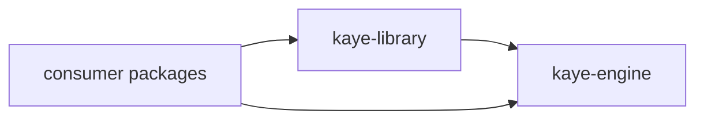

# kaye-library CONTEXT

**Last updated:** 2026-10-30, v1.1.1. History lives in `CHANGELOG.md` and `git log`, not here.

System knowledge for the **kaye-library** repository: architecture, boundaries, known gaps. Read alongside `AGENTS.md`.

## Project Overview

`kaye-library` is the shareable layer of a prompt stack. [kaye-engine](https://github.com/kami-lel/kaye-engine) supplies the mechanism (prompt tree, blueprints, exporters, command dispatcher) and bundles no content; this repository supplies reusable, persona-free content on top of it: style and naming rules, git and repository workflows, the agent workflow skeleton, and coding rules. It builds, tests, and exports standalone.



The dependency runs one way: `kaye_library` imports `kaye_engine`, never a consumer. Importing loads nothing.

| | |
|---|---|
| language | Python, 3.11 or newer |
| packaging | setuptools; console script `kaye-library`; `registrations/**/*.md` and `abbrs.json` ship as package data |
| runtime dependencies | `kaye-engine`, `kamilog` |
| test dependencies | `pytest`, `pydantic`, `pyyaml` |

## Repository Layout

```
kaye_library/
  __init__.py       the six steps, the consumer record, standalone setup
  __main__.py       console entry point
  abbrs.json        abbreviation entries of the glossaries library text splices
  registrations/    one folder per feature group: corpus .md beside its registrations
    _common.py      consumer-bound registration helpers, generic leaf helpers
    _dynamic_substitution.py  md-file dynamic substitution helper
tests/              mirrors the shipped surfaces; data.py holds the wording each skill renders
docs/               per-topic reference
```

## Integration Points

A host calls the steps in this order, or `setup_kaye_library_for_kaye_engine()` standalone:

1. `register_kaye_library_consumer()`: the `kaye-library` consumer record and the `Kaye Library vX` comment line
2. `register_kaye_library_abbr_glossaries()`, then `populate_abbr_data_with_json_file(get_kaye_library_abbrs_json_path())`
3. `register_kaye_library_dynamic_substitutions()`
4. `register_kaye_library_corpus()`: records every corpus file under its node; the host then registers its own sources and calls `load_corpus_tree()` once
5. `register_kaye_library_blueprints()`, once the tree is loaded

Standalone setup then names `kaye-library` the entry consumer and configures the Claude and Hermes CLIs with no chat, coder, or soul name; a subcommand needing one exits 1 with a clear message. A process runs exactly one setup: a host composing the steps never calls the standalone function.

Every exportable names its consumer at registration (`kaye-library`), so each consumer exports as its own plugin. A host may replace a library skill with `override_exportable(name, blueprint, consumer=...)` built over the library skill's own blueprint object, taken before the override: `commit-sense` and `coder` are each one library entry, and the skill keeps its name and moves to the host's plugin.

The console command builds on the engine's `register_cli_main_parser(PACKAGE_NAME, PROGRAM_NAME)`, so its `--help` text is the engine's and only the usage line and `--version` name `kaye-library`. `KAYE_LIBRARY_DISPLAY_NAME` (`Kaye Library`) names both the consumer record and the comment line.

## Corpus Structure

Seven authored root nodes plus two dynamic placements; every root has exactly one owner, so no path is ambiguous.

| root | holds |
|---|---|
| Agentic | `Agent~` sidecar, Turn Progress Dispatch, Files & Folders, Movement and Suite (Movement Notation, Movement with Count), Halt Each Movement, Cascade All Movements |
| Style Guide | Markdown Format (Extended, Footnotes, Endnotes, Header Separation), No Markdown Syntax, Letter Case, Briefness Style, Good Writing |
| Elements | Date and Time Format, Numerical Values with Units, Triage Tags, International Phonetic Alphabet, ASCII only, Alphabetical Sequence Numbering |
| Projects | Semantic Version, AGENTS and doc writers, Project Context Engineering |
| Repositories | Repository Structure, README, CHANGELOG, CONTEXT writers, create and maintain workflows, landing and release workflows |
| Git | Working with Git, commit sense, feature branch, Resolve Merge Conflict, Open Pull Request, Clean Up Branches |
| Coder | the coding rules, Brace Style, Comment Banner, Command Usage Message, Plan for Suite, Sync Unit Test, Gap Review; one child per language file |
| Amanuensis | Chicago Citation (Note, Bibliography), Bibliographer, assemble bibliography, Redactor, Dispositor with Scholiast, Config Writer (Keybinding Writer under it), Minutes Clerk |
| Secretary | Common Report Format and its info fields, email management (draft, sweep), scan event radar, calendar and GTD management, daily recap, hunt job opportunity, Good Morning, Good Week |
| Meta Prompt | Write Large Language Model Prompt and the skill-metadata writers (Write Skill Description, When to Use, both) |
| `(today)`, `(element-dt-days-of-week)` | dynamic placements carrying authored preface text |

- the language files register under `("Coder",)`; every other file registers under the root
- a consumer registers its own sources under the root or its own nodes and never reuses a library root name
- `#slug` links follow heading text, so a link from library text must point at library text
- a section no blueprint selects is a candidate for removal; a stub keeps its section and a placeholder `{description}`

## Content Boundary

- ships: reusable craft and conventions, written persona-free; a personal taste expressed as a rule ships as a default any consumer can override
- stays out: identity, contact data, accounts, schedules, finance, media libraries, personas and their routers, and any corpus no library blueprint selects
- `commit-sense` shows a generic, optional co-author trailer; a persona trailer is a host's to add through `override_exportable`
- the `Coder` root carries no conversation rules: the `coder` skill carries the rules alone, so every language profile that invokes `coder` resolves under the standalone command, and a host takes `coder` over to add its conversation rules and persona around the `coder` blueprint object

## Abbreviation Database

- `abbrs.json` holds only the entries of glossaries library text splices, each with its glossaries and rendering flags (`term_definition` and the case and character flags); it loads standalone and names only registered library glossaries
- a host ships its own file and adds its glossaries or habit flags (`always_understand`, `common`) by repeating a pair: `priority` and `wrap` must match, a missing `remark` may be filled at either level, a conflicting one raises
- the library claims no tag, wrap, or first-char abbr group: those belong to the host that names itself their consumer, so a standalone library exports only its `glossary-*` groups

## Naming of Skills

Exportable skills only; internal blueprints keep their slugs. Twin groups share one verb by design. Workflow skills here: `commit-sense`, `prune-merged-branches`, `submit-pr`, `ready-land-feature`, `ready-release-version`, `land-feature`, `release-version`, `review-gaps`, `sync-unit-test`.

## Testing Strategy

`pytest`, serial. `tests/conftest.py` loads the library once per session and exports every skill as folders and as `.zip` packages in-process. `skill_export_test.py` checks structure, frontmatter, and wording from `data.py` for both forms; `console_test.py` and `third_consumer_test.py` run subprocesses; `privacy_test.py` scans every shipped file. Run commands live in `AGENTS.md`.

## Known Gaps & Constraints

- **consumer placeholders in Secretary skills**: `sweep-email-inbox` and the event radar splice a glossary or substitution the library does not register (`secretary-work-color-legend`, `secretary-email-authuser`); run alone, their placeholders render literally, and a consumer registers them. The calendar, GTD, and email category glossaries (`secretary-calendar-name`, `secretary-gtd-project`, `secretary-email-category`) ship with the library
- **stubs**: `land-feature`, `release-version`, and `submit-pr` render placeholder text until their sections are written
- **no Claude surfaces standalone**: the library registers no affordance groups or surface profiles, so conditional `{[ClaudeCode:...]}` sidecars never render under the standalone command, only their fallbacks
- **`ASCII only` is linked from commit sense**: `git-sense-core` selects it; moving it breaks the link
- **pre-existing broken links**: `#style-briefness-style` in several sections and `#movement-2-write-the-plan` in `Plan for Suite` point at no heading
