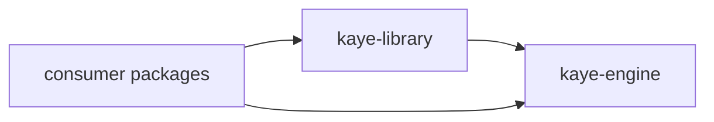

# kaye-library CONTEXT

**Last updated:** 2026-11-13, v1.3.0. History lives in [CHANGELOG.md](CHANGELOG.md) and `git log`, not here.

System knowledge for the **kaye-library** repository: architecture, boundaries, known gaps. Read alongside [AGENTS.md](AGENTS.md); [README.md](README.md) is the landing page.

## Project Overview

`kaye-library` is the shareable layer of a prompt stack. [kaye-engine](https://github.com/kami-lel/kaye-engine) supplies the mechanism (prompt tree, blueprints, exporters, command dispatcher) and bundles no content; this repository supplies reusable, persona-free content on top of it: style and naming rules, git and repository workflows, the agent workflow skeleton, and coding rules. It builds, tests, and exports standalone.



The dependency runs one way: `kaye_library` imports `kaye_engine`, never a consumer. Importing loads nothing.

| | |
|---|---|
| language | Python, 3.11 or newer |
| packaging | setuptools; console script `kaye-library`; `registrations/**/*.md` and `abbrs.json` ship as package data |
| runtime dependencies | `kaye-engine` (git reference at an exact tag, not on PyPI), `kamilog` (git, pinned at `v3.0.0`) |
| release | `.github/workflows/release.yml`: a `v*` tag equal to the `pyproject.toml` version builds the plugin zip with `build-github-release` and attaches it to a GitHub Release, a pre-release for `-alpha` and `-beta` |
| test dependencies | `pytest`, `pydantic`, `pyyaml` |

## Repository Layout

```
kaye_library/
  __init__.py       the six steps, the consumer record, standalone setup
  __main__.py       console entry point
  abbrs.json        abbreviation entries of the glossaries library text splices
  registrations/    one folder per feature group: corpus .md beside its registrations
    _common.py      consumer-bound registration helpers, generic leaf helpers
    _dynamic_substitution.py  md-file dynamic substitution helper
tests/              mirrors the shipped surfaces; data.py holds the wording each skill renders
.github/workflows/  tag-triggered release build
```

## Integration Points

A host calls the six steps in this order, or `setup_kaye_library_for_kaye_engine()` standalone:

1. `register_kaye_library_consumer()`: the `kaye-library` consumer record and the `Kaye Library vX` comment line
2. `register_kaye_library_abbr_glossaries()`: every abbr glossary
3. `populate_abbr_data_with_json_file(get_kaye_library_abbrs_json_path())`: the abbr data, once the glossaries exist
4. `register_kaye_library_dynamic_substitutions()`
5. `register_kaye_library_corpus()`: records every corpus file under its node; the host then registers its own sources and calls `load_corpus_tree()` once
6. `register_kaye_library_blueprints()`, once the tree is loaded

Standalone setup then registers the chat base (`registrations/chat/`): a persona-free `chat` over the Markdown style, chat sequence numbering, Agentic and Turn Progress Dispatch, and the `Chat Agent` corpus (a root node every consumer receives, registered with the six steps); a non-invokable `chat-coder` merging `chat` with `coder`; and the default `secretary-email-authuser` of `0`. It names `kaye-library` the entry consumer and configures the Claude CLI with `chat` and `chat-coder` and Hermes with the `chat` soul. A process runs exactly one setup: a host composing the steps never calls the standalone function, so it never sees the chat base and supplies its own.

Every exportable names its consumer at registration (`kaye-library`), so each consumer exports as its own plugin. A host may replace a library skill with `override_exportable(name, blueprint, consumer=...)` built over the library skill's own blueprint object, taken before the override: `commit-sense` and `coder` are each one library entry, and the skill keeps its name and moves to the host's plugin.

The console command builds on the engine's `register_cli_main_parser(PACKAGE_NAME, PROGRAM_NAME)`, so its `--help` text is the engine's and only the usage line and `--version` name `kaye-library`. `KAYE_LIBRARY_DISPLAY_NAME` (`Kaye Library`) names both the consumer record and the comment line.

## Corpus Structure

Twelve authored root nodes plus two dynamic placements; every root has exactly one owner, so no path is ambiguous.

| root | holds |
|---|---|
| Agentic | `Agent~` sidecar, Turn Progress Dispatch, Files & Folders, Movement and Suite (Movement Notation, Movement with Count), Halt Each Movement, Cascade All Movements |
| Chat Agent | the persona-free conversation rules: reply Language, Discourse Unit, Directive, Chat Emojis Decorative, letter-labeled options, the question-tool sections; registered with the six steps, taken by the standalone `chat` |
| Style Guide | Markdown Format (Extended, Footnotes, Endnotes, Header Separation), No Markdown Syntax, Letter Case, Briefness Style, Good Writing |
| Elements | Date and Time Format, Numerical Values with Units, Triage Tags, International Phonetic Alphabet, ASCII only, Alphabetical Sequence Numbering |
| Projects | Semantic Version, AGENTS and doc writers, Project Context Engineering |
| Git | `git.md`: Working with Git, commit sense, Resolve Merge Conflict; `repo.md`: Repository Structure, README, CHANGELOG, CONTEXT writers, Prune Merged Branches, Submit Pull Request; `workflow.md`: create and maintain workflows; `branch.md`: feature branch, landing and release workflows |
| Perforce | Working with Perforce |
| Coder | the coding rules, Brace Style, Comment Banner, Command Usage Message, Plan for Suite, Sync Unit Test, Gap Review; one child per language file |
| Unity Engine | the Unity 6 C# rules (naming, class-role suffixes, inspector fields, units, input, owner-driven activation, game tuning, logging), Assets Management, MonoBehaviour, Scriptable Object; each section also exports as its own standalone `u3d-*` skill; builds on Coder C Sharp |
| Amanuensis | Chicago Citation (Note, Bibliography), Bibliographer, assemble bibliography, Redactor, Dispositor with Scholiast, Config Writer (Keybinding Writer under it), Minutes Clerk |
| Secretary | Common Report Format and its info fields, email management (draft, sweep), scan event radar, calendar and GTD management, daily recap, hunt job opportunity, Good Morning, Good Week |
| Meta Prompt | Write Large Language Model Prompt and the skill-metadata writers (Write Skill Description, When to Use, both) |
| `(today)`, `(element-dt-days-of-week)` | dynamic placements carrying authored preface text |

- the language files register under `("Coder",)`; every other file, Unity Engine included, registers under the root
- a consumer registers its own sources under the root or its own nodes and never reuses a library root name
- `#slug` links follow heading text, so a link from library text must point at library text
- `_CORPUS_SOURCES` in `kaye_library/__init__.py` pairs a node path with a file, in registration order; a source's top headings sit exactly one level below its target, or loading raises (the format is the engine's [corpus documentation](https://github.com/kami-lel/kaye-engine/blob/dev/docs/corpus-doc.md))
- a section no blueprint selects is a candidate for removal; a stub keeps its section and a placeholder `{description}`

## Registration Helpers

`registrations/_common.py` binds the `kaye-library` consumer; blueprints register only through it, in `registrations/<group>/<group>_bp.py`, after every blueprint they depend on (a missing dependency raises at registration):

| helper | registers |
|---|---|
| `register_exportable` | an exportable skill, invokable by the user and the assistant |
| `register_prompt` | an exportable skill the assistant does not surface on its own (`llm_invokable=False`) |
| `register_node` | a node (optionally recursive) under a slug, through any of the above |
| `register_leaf` | one leaf with its ancestor headings, descriptors included |
| `register_blueprint(..., is_exportable=False)` | an internal building block, never exported |

Glossaries register in `registrations/<group>/<group>_glossary.py` through `register_abbr_glossary`, named `-abbr` (decode-only), `-shorthand` (the assistant may replace words) or `-decorative` (the assistant accompanies text). List skills with `kaye-library x ls`, glossaries with `kaye-library g ls`, a blueprint's wiring with `kaye-library bp show`; the full graph is in the [blueprint documentation](docs/blueprint-doc.md).

## Content Boundary

- ships: reusable craft and conventions, written persona-free; a personal taste expressed as a rule ships as a default any consumer can override
- stays out: identity, contact data, accounts, schedules, finance, media libraries, personas and their routers, and any corpus no library blueprint selects
- `tests/privacy_test.py` scans every shipped file for strings that must stay out: extend its generic list for a new kind of string; personal strings live in the gitignored `tests/privacy-forbidden.local.txt` (1 per line, `#` comments), and without it only the generic check runs
- `commit-sense` shows a generic, optional co-author trailer; a persona trailer is a host's to add through `override_exportable`
- the `Coder` root carries no conversation rules: the `coder` skill carries the rules alone, so every language profile that invokes `coder` resolves under the standalone command, and a host takes `coder` over to add its conversation rules and persona around the `coder` blueprint object

## Abbreviation Database

- `abbrs.json` holds only the entries of glossaries library text splices, each with its glossaries and rendering flags (`term_definition` and the case and character flags); it loads standalone and names only registered library glossaries
- a host ships its own file and adds its glossaries or habit flags (`always_understand`, `common`) by repeating a pair: `priority` and `wrap` must match, a missing `remark` may be filled at either level, a conflicting one raises
- the library claims no tag, wrap, or first-char abbr group: those belong to the host that names itself their consumer, so a standalone library exports only its `glossary-*` groups

## Contract With Consumers

- renaming a skill breaks every outside reference and keeps no alias: record it in `CHANGELOG.md` under Changed
- a node path is part of the contract, since a consumer's blueprint selects library nodes by path: moving a section is a breaking change
- building a consumer or taking a skill over is documented in the engine's [Consumer documentation](https://github.com/kami-lel/kaye-engine/blob/dev/docs/consumer-doc.md); [examples/minimal-consumer](examples/minimal-consumer/example_consumer/__init__.py) is the working version

## Naming of Skills

Exportable skills only; internal blueprints keep their slugs. Twin groups share one verb by design; list the workflow skills with `kaye-library x ls`.

## Testing Strategy

`pytest`, serial. `tests/conftest.py` loads the library once per session and exports every skill as folders and as `.zip` packages in-process. `skill_export_test.py` checks structure, frontmatter, and wording from `data.py` for both forms; `console_test.py` and `third_consumer_test.py` run subprocesses; `privacy_test.py` scans every shipped file. Run commands live in [AGENTS.md](AGENTS.md).

## Known Gaps & Constraints

- **consumer placeholders in Secretary skills**: the standalone setup registers a default `secretary-email-authuser`; a composing host registers its own, and a placeholder no one registers renders literally
- **`{[X] Usage}` sections render side by side**: the library registers no affordance groups or surface profiles, so each conditional `{[Claude:...] Usage}` and `{[Hermes:...] Usage}` sidecar renders as an ordinary section under the standalone command, every surface's variant in sequence; this is the design, and a host that registers surface profiles gets the conditional behavior
- **`ASCII only` is linked from commit sense**: `git-sense-core` selects it; moving it breaks the link
