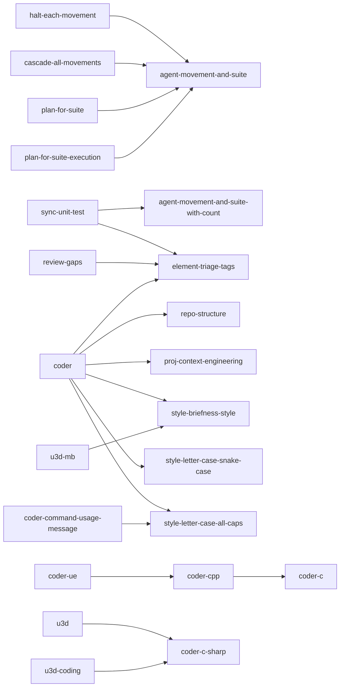
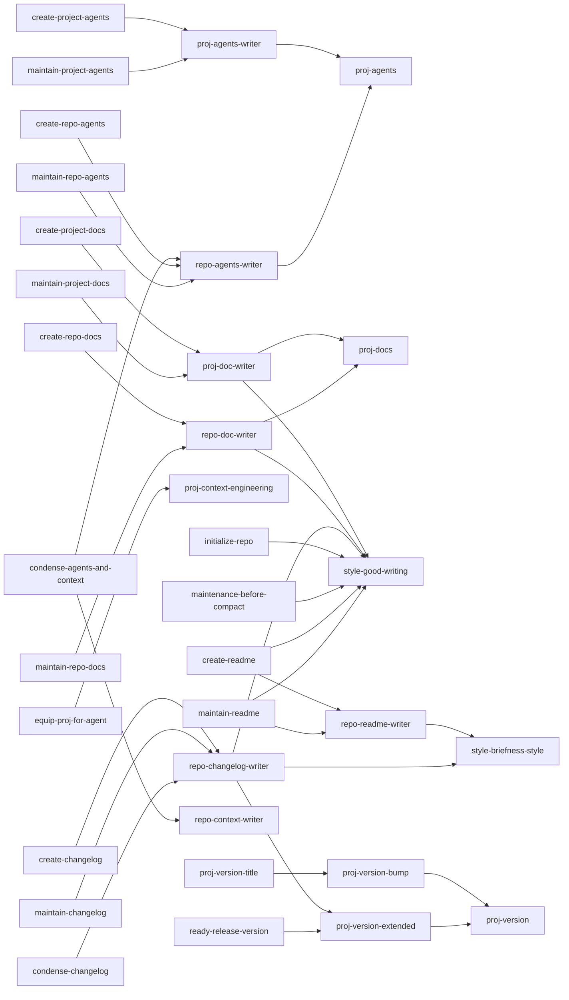
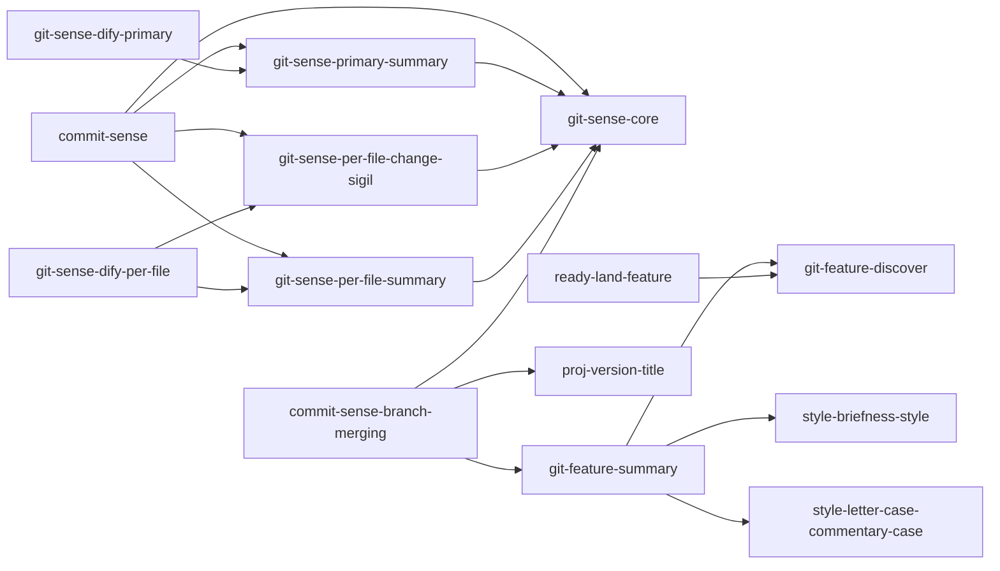
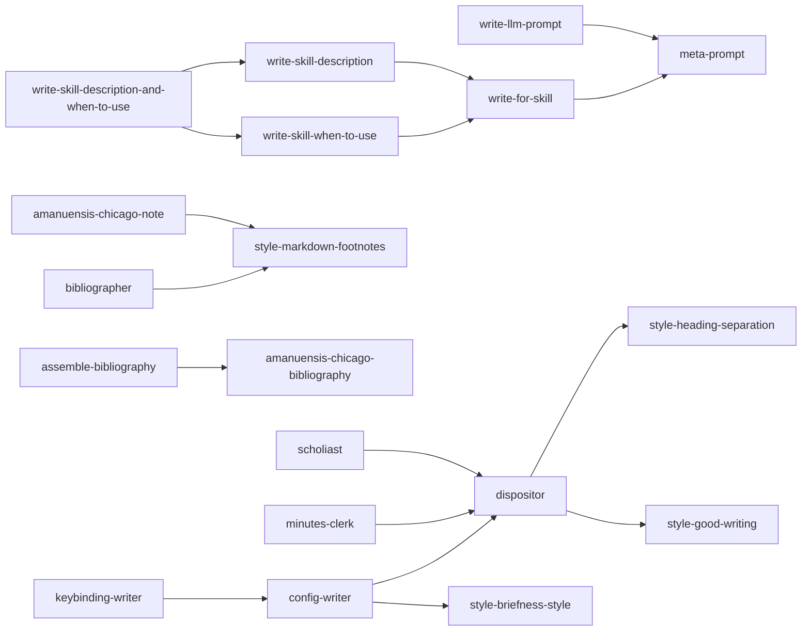
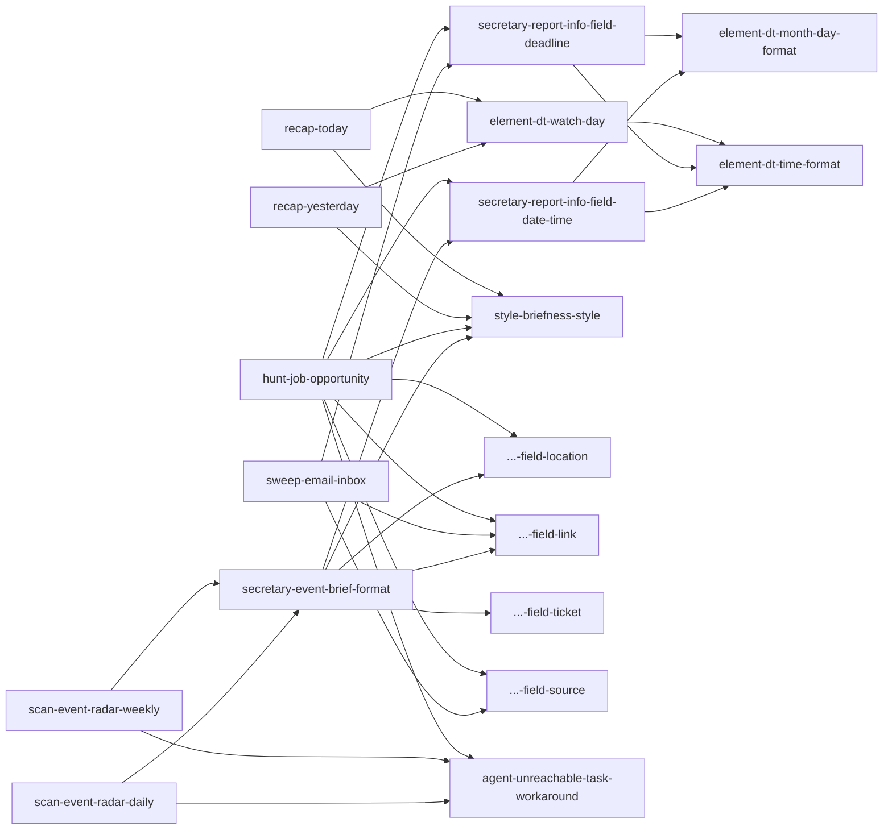
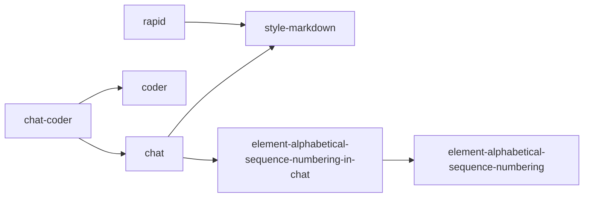
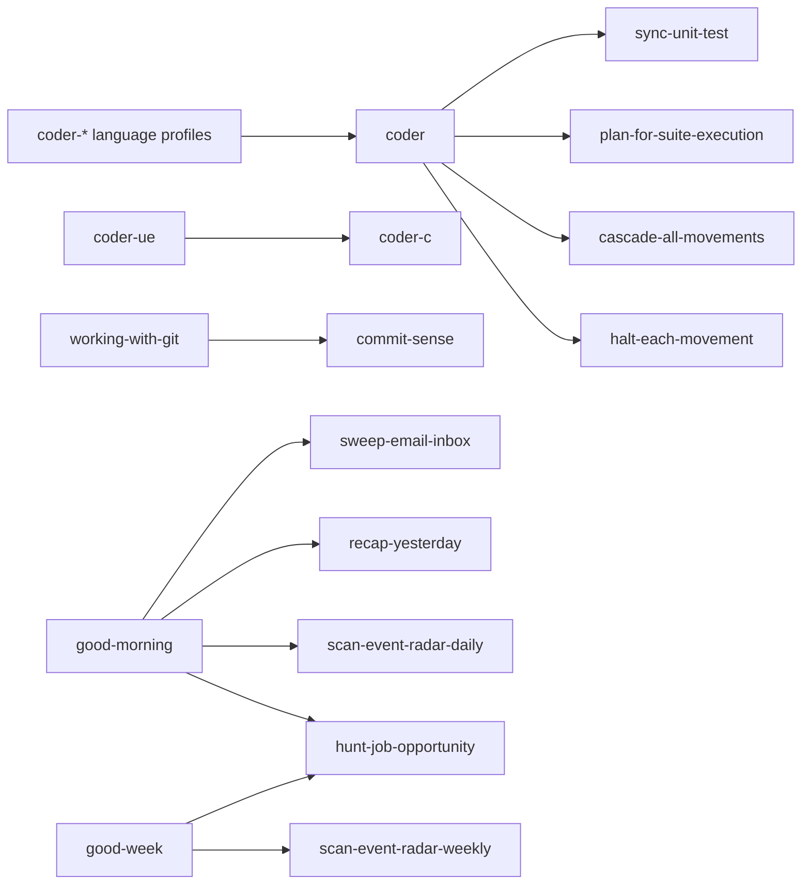

# kaye-library: Blueprint Documentation

How the library's blueprints connect; the rest is a command away: `kaye-library blueprint list`, `blueprint show NAME`, `blueprint preview NAME`, `exportable ls`. A blueprint name is contract for [consumers](https://github.com/kami-lel/kaye-engine/blob/dev/docs/consumer-doc.md). Rules for changing one are in [AGENTS.md](../AGENTS.md), the architecture in [CONTEXT.md](../CONTEXT.md), the overview in the [README](../README.md).

## Blueprint Dependency Graph

Every `dependencies=[...]` edge a library blueprint declares; `A --> B` reads "A depends on B".

#### Agentic & Coder

#### Repository & Project

#### Git

#### Meta Prompt & Amanuensis

#### Secretary

#### Standalone Chat

## Blueprint Invocation Graph

Every `Invoke ... skill via Skill tool` call; `A --> B` reads "A invokes B" at runtime.

