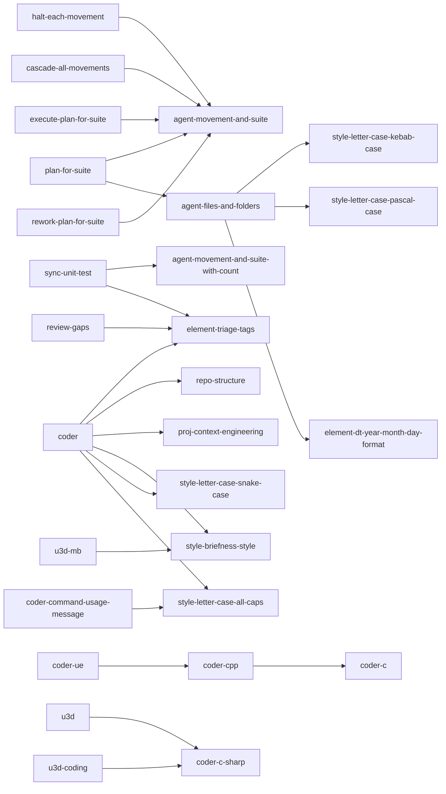
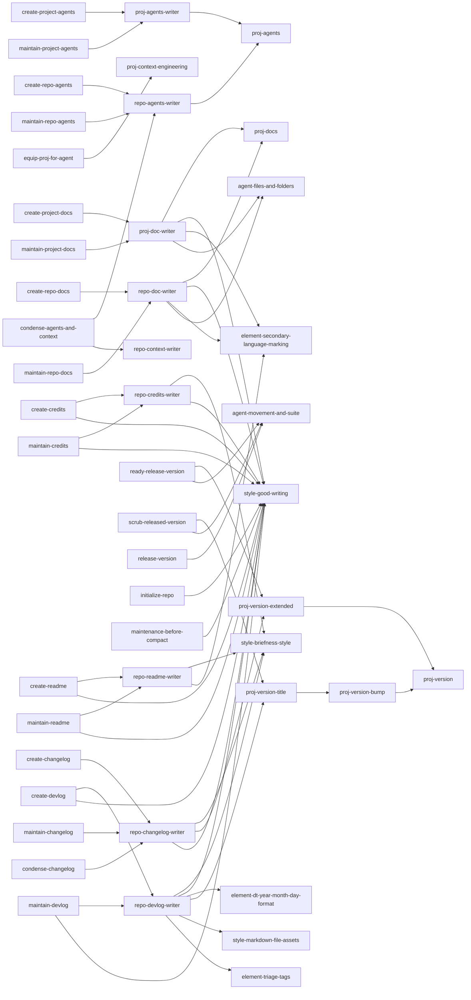
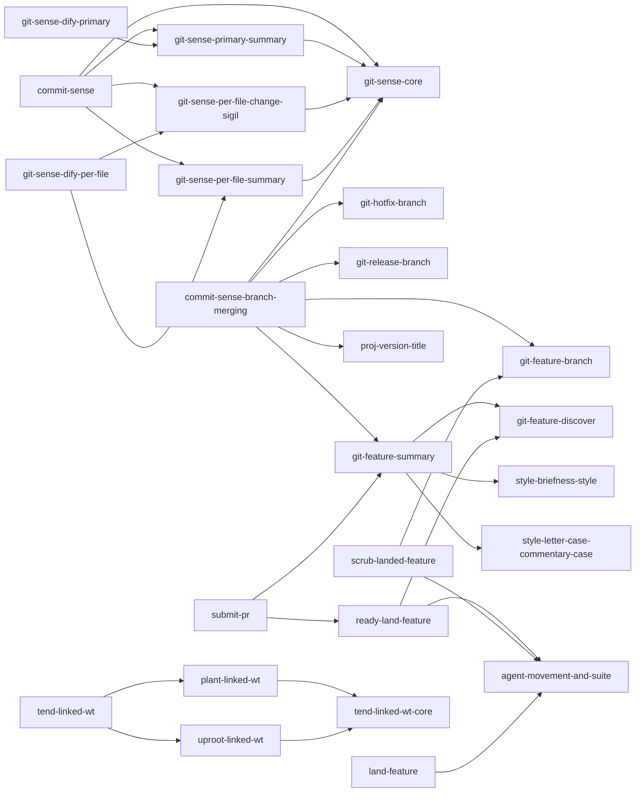
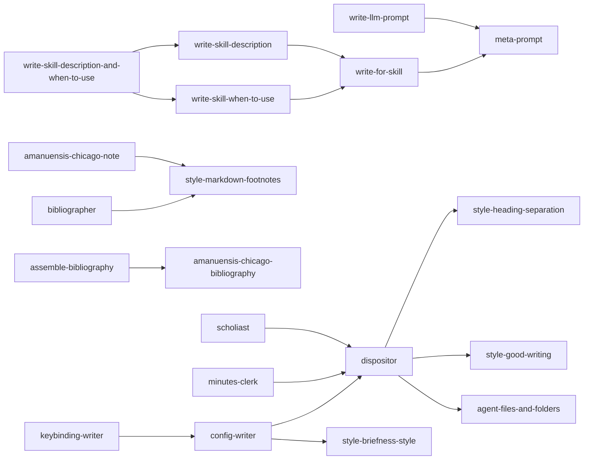
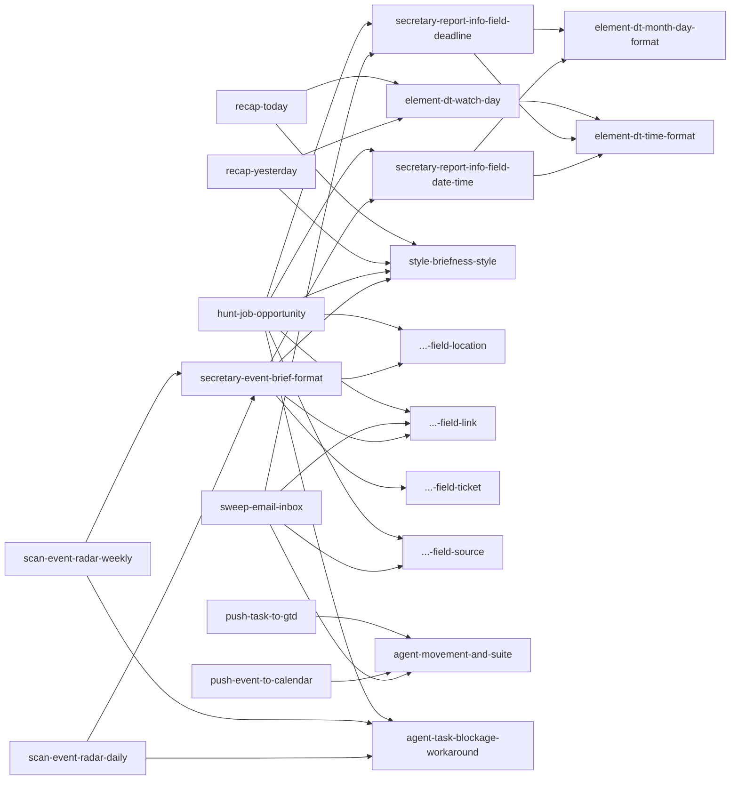
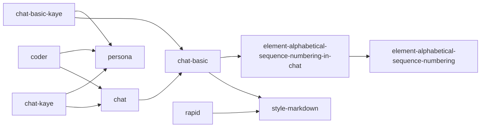
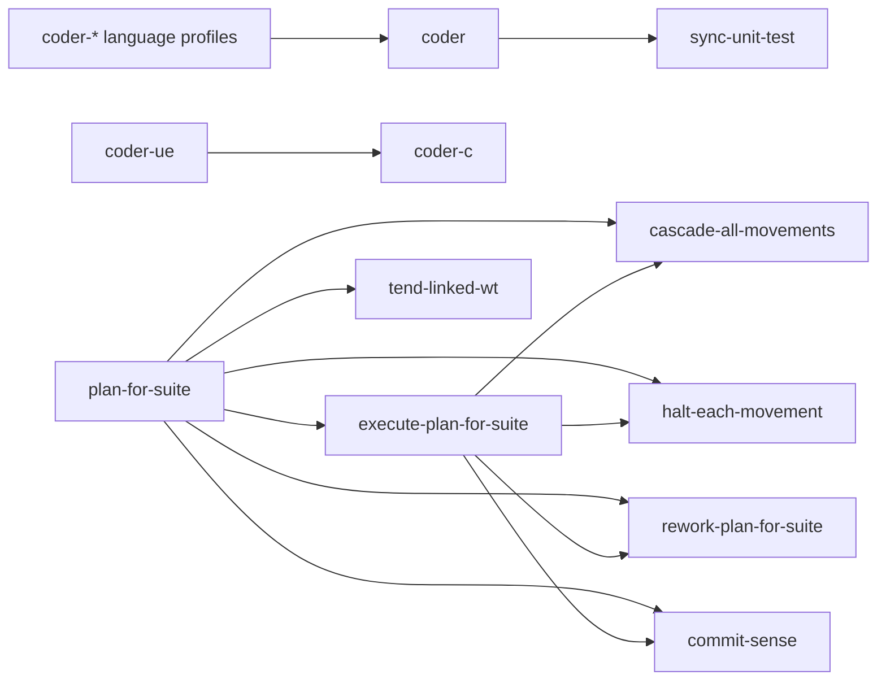
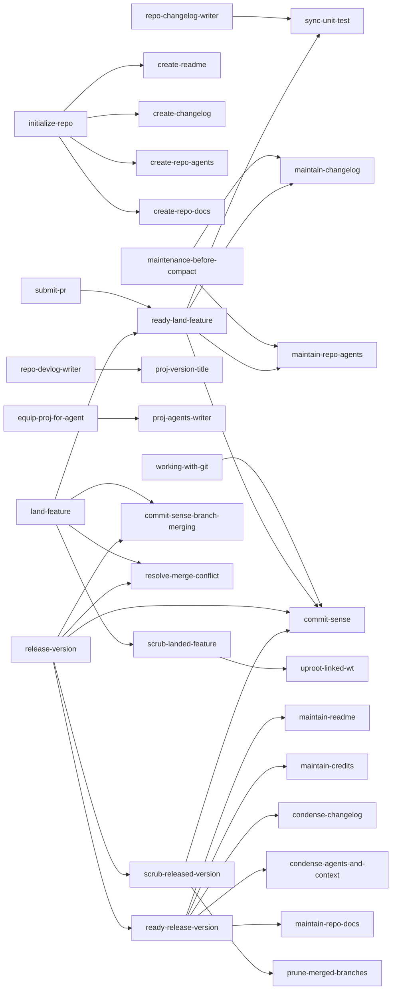
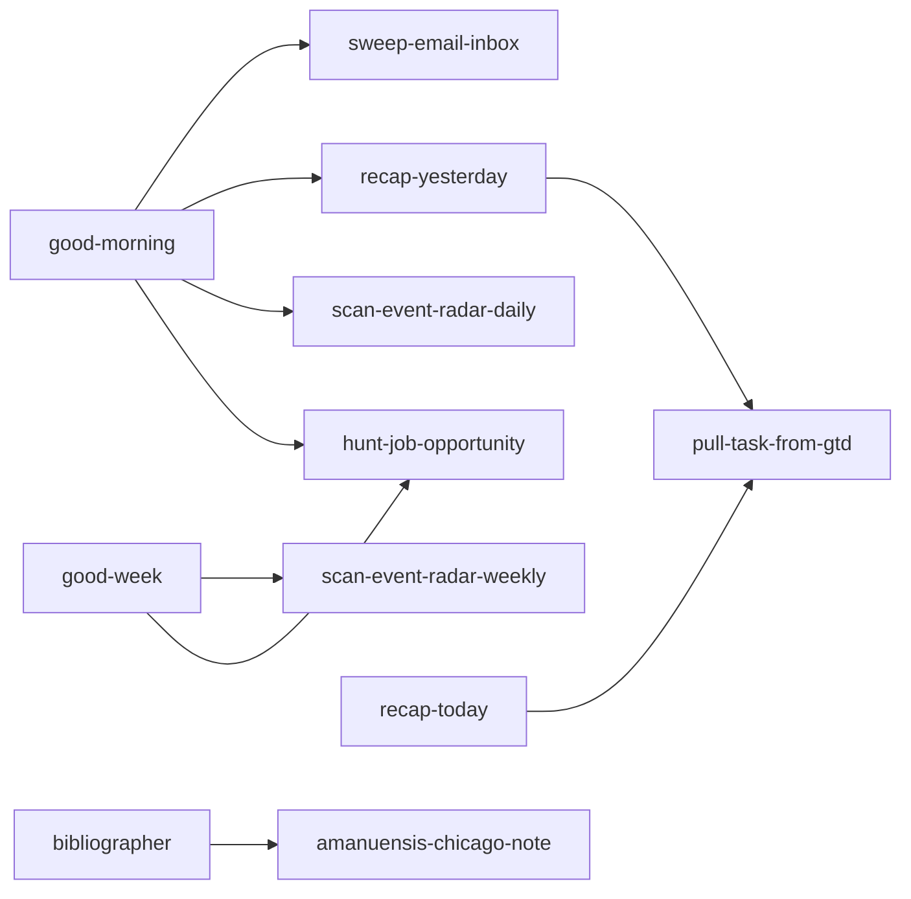
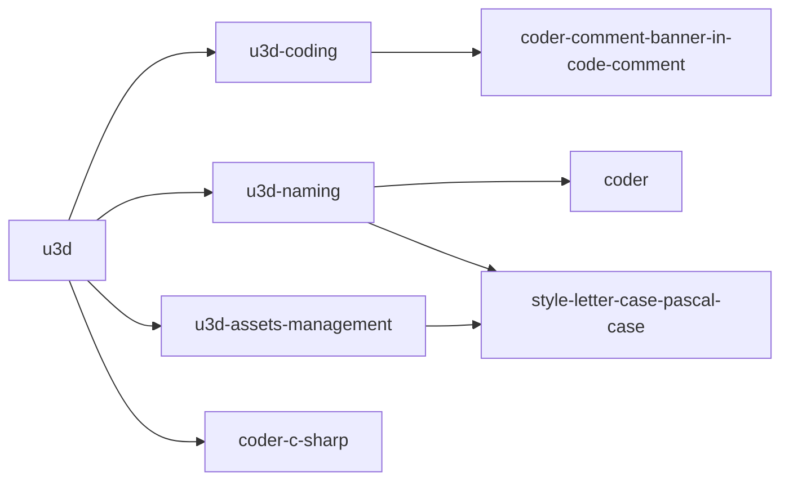

# Kaye Library: Blueprint Documentation

How the library's blueprints connect; the rest is a command away: `kaye-library blueprint list`, `blueprint show NAME`, `blueprint preview NAME`, `exportable ls`. A blueprint name is contract for [consumers](https://github.com/kami-lel/kaye-engine/blob/dev/docs/consumer-doc.md). Rules for changing one are in [AGENTS.md](../AGENTS.md), the architecture in [CONTEXT.md](../CONTEXT.md), the overview in the [README](../README.md).

## Blueprint Dependency Graph

Every `dependencies=[...]` edge a library blueprint declares; `A --> B` reads "A depends on B".

#### Agentic & Coder

#### Repository & Project

#### Git

#### Meta Prompt & Amanuensis

#### Secretary

#### Chat

## Registration

Every blueprint registers in `kaye_library/registrations/<group>/<group>_bp.py` through the helpers of `registrations/_common.py`: `register_exportable`, `register_prompt`, `register_internal` and `register_abbr_glossary`, bound to the `kaye-library` consumer by the engine's `bind_registrars`, plus the engine's `register_node`, `register_leaf` and `glossary_blueprint`, which `_common.py` re-exports. They are `kaye-engine` public API, so a third consumer builds its own the same way; see the engine's [Registration Helpers](https://github.com/kami-lel/kaye-engine/blob/dev/docs/prompt-doc.md#registration-helpers). A blueprint is built whole before it registers, never edited afterwards.

`chat` and `persona` are internal and persona-free; `chat-kaye`, `chat-basic-kaye` and `coder` stack on them and turn `for Kaye` and `in chat` on, so the entry's render profile picks the persona and the chat format. A consumer replaces `chat` or `persona` in place with `override_blueprint`, so every entry picks up its version by name, and re-homes `chat-kaye` into its plugin with `override_exportable`; `coder` never depends on `chat-kaye`, so what a consumer adds there stays out of `coder`.

## Blueprint Invocation Graph

Every `Invoke ... skill via Skill tool` call a skill's own text makes, dependencies' calls left to them; `A --> B` reads "A invokes B" at runtime.

#### Agentic & Coder

#### Git & Repository

#### Secretary & Amanuensis

#### Unity

Each Unity skill may invoke its siblings "if needed"; the entry points are shown, the sibling web is in `u3d.md`.

