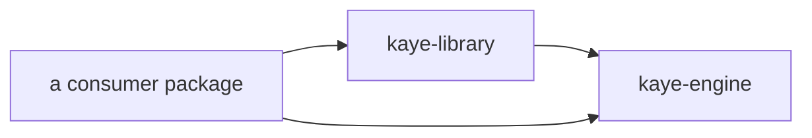

# Boundary Documentation

The library is the shareable layer between the engine and any package that builds on it. This document states what crosses that boundary in each direction; the architecture around it is in [CONTEXT.md](../CONTEXT.md), the rules an agent follows in [AGENTS.md](../AGENTS.md#content-rules).



## What the Library Never Contains

- personal data: names, contact data, accounts, schedules, finance, media libraries
- a persona, or a router wiring a persona to roles
- text naming a package that depends on the library
- corpus no library blueprint selects, except a stub awaiting its text

`tests/privacy_test.py` scans every shipped file for the strings that would break this; extend its list when a new kind of string must stay out.

## What the Library Never Imports

`kaye_library` imports only `kaye_engine` and `kamilog`. Importing it loads nothing: registration happens when a host calls the steps, so two packages can build on it in one process without ordering surprises.

## Consumers and Plugins

Each package registers its own consumer record with `register_consumer`; the library registers `kaye-library`. Every exportable names its consumer at registration, and **one consumer is one plugin**: an export writes a plugin per consumer, named and versioned from its own record and its own installed distribution, under one marketplace named `kaye-engine`. A skill therefore lives in exactly one plugin.

| process | consumers | `claude plugin` writes |
|---|---|---|
| `kaye-library` command | `kaye-library` (entry) | `kaye-library/` |
| a package composing the library | `kaye-library`, its own (entry) | one folder per consumer |

A process runs exactly one setup: the standalone `setup_kaye_library_for_kaye_engine()`, or a host calling the six steps itself.

## Taking a Skill Over

A package that wants its own version of a library skill builds it over the library's internal blueprint and registers it with `override_exportable`, which validates the blueprint, moves the skill to the package's plugin, and keeps the other flags:

```python
from kaye_engine import override_exportable
from kaye_engine.prompt.blueprint import create_blueprint, get_blueprint, replace_meta

meta = get_blueprint("commit-sense").blueprint.meta
bp = replace_meta(
    create_blueprint(dependencies=["commit-sense-core", "my-trailer-rules"]),
    display_name=meta.display_name,
    description_node=meta.description_node,
    when_to_use_node=meta.when_to_use_node,
)
override_exportable("commit-sense", bp, consumer="my-package")
```

The library's own `commit-sense` shows an optional, generic co-author trailer; the override adds whatever rules and identity the package wants, so the library's plugin never carries them. `coder` works the same way: the library's skill is `coder-core` alone, and a package's override adds its conversation rules around `coder-core`, optionally with `always_apply=True`. Every language profile that tells the assistant to invoke `coder` then reaches the package's version.

## Abbreviation Layers

The library ships `abbrs.json` with only the entries its glossaries need. A package loads its own file after it with `populate_abbr_data_with_json_file`; the files add together.

- a package may repeat a library (abbreviation, meaning) pair to add its own glossaries or flags to it
- a repeat restates `priority` and `wrap` unchanged; a differing value raises
- a `remark` missing at the meaning or the entry level may be filled by the later file; a conflicting one raises
- rendering flags (`term_definition`, the case and character flags) belong to the library's copy; habit flags (`always_understand`, `common`) to the file of the package holding the habit
- the library claims no tag, wrap, or first-letter abbr group: the package naming itself their consumer owns them, so a standalone library exports only its `glossary-*` skills

The glossaries themselves are listed in the [glossary document](glossary-doc.md).

## Updating Across the Boundary

- renaming a skill breaks every outside reference to it, and no alias is kept: record the rename in `CHANGELOG.md` under Changed
- a node path is part of the contract: a package's blueprint selects library nodes by path, so moving a section is a breaking change
- link only to library text from library text; a link to a heading a package supplies resolves to nothing under the standalone command
