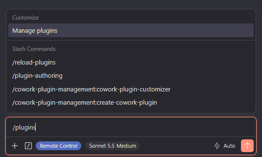
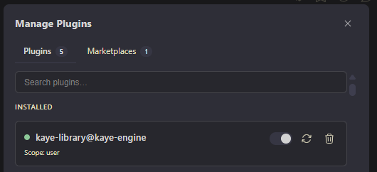

# Kaye Library: Claude Usage Documentation

English | [简体中文](claude-usage-doc.zh-CN.md)

Install `kaye-library` in Claude Desktop or the Claude Code VS Code Extension: pick any one of the methods below.

## for Claude Desktop

There are 3 ways to install in Claude Desktop:

### ⓐ Add the Marketplace by URL

1. Click *Customize* in the sidebar.

   

2. Open the *Plugins* tab.

   

3. Click *Add* → *Add marketplace*.

   

4. Choose *Add from a repository*.

   

5. Type this in the *URL* field, then choose *Use "kami-lel/kaye-library-marketplace"*:

   ```text
   kami-lel/kaye-library-marketplace
   ```

   

6. Click *Sync*.

   

7. In the *Discover* view, click *Add* beside *Kaye Library*.

   


### ⓑ Upload the Release Zip

Download a ready-made plugin file, then upload it.

1. Download `kaye-library-VERSION-claude-desktop-plugin.zip` from the [GitHub Releases page](https://github.com/kami-lel/kaye-library/releases).
2. Upload it as in [Upload Plugin as Zip File](#upload-plugin-as-zip-file).


### ⓒ Build and Upload the Zip

Make the plugin file yourself, then upload it.

1. Build the zip:

   ```bash
   kaye-library claude plugin -z
   ```

2. Upload `kaye-library-claude-VERSION.zip` from the current directory, as in [Upload Plugin as Zip File](#upload-plugin-as-zip-file).


### Upload Plugin as Zip File

1. Click *Customize* in the sidebar.

   

2. Open the *Plugins* tab.

   

3. Click *Add* → *Upload plugin*.

   

4. Drop the zip into the dialog, or browse for it, then click *Upload*.

   


## for Claude Code VS Code Extension

There are 4 ways to install in the Claude Code VS Code Extension: pick one, then verify it, as in [Check Installed Plugins](#check-installed-plugins).

### ⓐ Add the Marketplace by URL

1. In the *Claude Code* panel, type `/` and choose *Manage plugins*.

   

2. Open the *Marketplaces* tab. Type this in the field, then click *Add*:

   ```text
   kami-lel/kaye-library-marketplace
   ```

   

3. Check that `kaye-library-marketplace` is listed.

   

4. Open the *Plugins* tab. Under *Available*, click *Install* beside `kaye-library`.

   

5. Check that `kaye-library@kaye-library-marketplace` is listed under *Installed*.

   

6. Restart VS Code.


### ⓑ Run the One-Click Installer on Windows

Download a ready-made installer, then run it.

1. Download `kaye-library-VERSION-claude-vsc-installer-Win.zip` from the [GitHub Releases page](https://github.com/kami-lel/kaye-library/releases).
2. Extract it, then double-click `install.cmd`.
3. Restart VS Code.
4. Check the result, as in [Check Installed Plugins](#check-installed-plugins).


### ⓒ Run the One-Click Installer on Linux

Download a ready-made installer, then run it.

1. Download `kaye-library-VERSION-claude-vsc-installer-linux.run` from the [GitHub Releases page](https://github.com/kami-lel/kaye-library/releases).
2. Run:

   ```bash
   bash kaye-library-VERSION-claude-vsc-installer-linux.run
   ```

3. Restart VS Code.
4. Check the result, as in [Check Installed Plugins](#check-installed-plugins).


### ⓓ Run the Setup Command

Install it yourself with one command.

1. Run:

   ```bash
   kaye-library claude vs-code-extension
   ```

2. Restart VS Code.
3. Check the result, as in [Check Installed Plugins](#check-installed-plugins).


### Check Installed Plugins

1. In the *Claude Code* panel, type `/` and choose *Manage plugins*.

   

2. Open the *Plugins* tab. Check that `kaye-library` is listed under *Installed*, its toggle on.

   

3. Open the *Marketplaces* tab. Check that `kaye-library` is listed.

   
