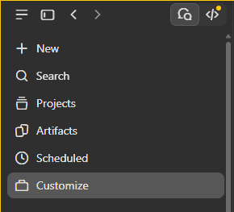
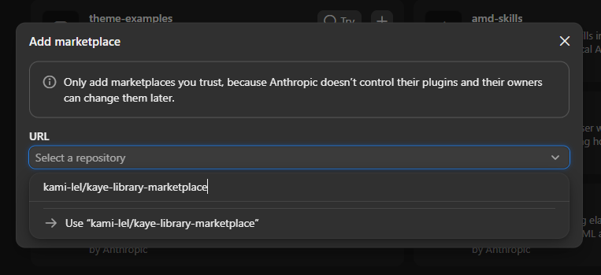
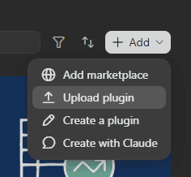
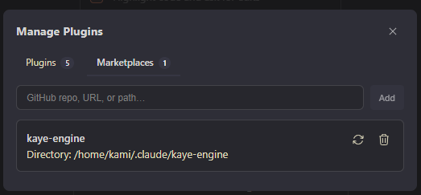

# kaye-library: Claude Usage Documentation

Install `kaye-library` in Claude Desktop or the Claude Code VS Code Extension: pick any one of the methods below.

<!--
TODO zh version of claude usage doc
-->

## for Claude Desktop

### ⓐ Add the Marketplace by URL

1. Click *Customize* in the sidebar.

   

2. Open the *Plugins* tab.

   

3. Click *Add* → *Add marketplace*.

   

4. Choose *Add from a repository*.

   

5. Type this in the *URL* field, then choose *Use "kami-lel/kaye-library-marketplace"*:

   ```text
   kami-lel/kaye-library-marketplace
   ```

   

6. Click *Sync*.

   


### ⓑ Upload the Release Zip

Download a ready-made plugin file, then upload it.

1. Download `kaye-library-VERSION-claude-desktop-plugin.zip` from the [GitHub Releases page](https://github.com/kami-lel/kaye-library/releases).
2. Upload it as in [Upload Plugin as Zip File](#upload-plugin-as-zip-file).


### ⓒ Build and Upload the Zip

Make the plugin file yourself, then upload it.

1. Build the zip:

   ```bash
   kaye-engine claude plugin -z
   ```

2. Upload `CONSUMER-claude-VERSION.zip` from the current directory, as in [Upload Plugin as Zip File](#upload-plugin-as-zip-file).


### Upload Plugin as Zip File

1. Click *Customize* in the sidebar.

   

2. Open the *Plugins* tab.

   

3. Click *Add* → *Upload plugin*.

   

4. Drop the zip into the dialog, or browse for it, then click *Upload*.

   


## for Claude Code VS Code Extension

### ⓐ Add the Marketplace by URL

1. In the *Claude Code* panel, run:

   ```text
   /plugin marketplace add kami-lel/kaye-library-marketplace
   ```

   <!-- TODO screen cap `assets/claude-vsc-marketplace-step-1-add.png`: the *Claude Code* panel, the command typed in, before sending -->

2. Run:

   ```text
   /plugin install kaye-library@kaye-library-marketplace
   ```

   <!-- TODO screen cap `assets/claude-vsc-marketplace-step-2-install.png`: the *Claude Code* panel, the install command and its success reply -->

3. Restart VS Code.
4. Check the result, as in [Check Installed Plugins](#check-installed-plugins).


### ⓑ Run the One-Click Installer

Download a ready-made installer, then run it.

1. Download the installer for your system from the [GitHub Releases page](https://github.com/kami-lel/kaye-library/releases), then run it:
   - Windows: extract `kaye-library-VERSION-claude-vsc-installer-Win.zip`, then double-click `Install.cmd`
   - Linux: run `bash kaye-library-VERSION-claude-vsc-installer-linux.run`

   <!-- TODO screen cap `assets/claude-vsc-installer-step-1-release-assets.png`: the release page *Assets* list, both installer files visible -->
   <!-- TODO screen cap `assets/claude-vsc-installer-step-1-windows.png`: the extracted folder in Explorer, `Install.cmd` selected -->
   <!-- TODO screen cap `assets/claude-vsc-installer-step-1-linux.png`: the terminal after `bash ...-linux.run`, its success output -->

2. Restart VS Code.
3. Check the result, as in [Check Installed Plugins](#check-installed-plugins).


### ⓒ Run the Setup Command

Install it yourself with one command.

1. Run:

   ```bash
   kaye-engine claude vs-code-extension
   ```

   <!-- TODO screen cap `assets/claude-vsc-setup-step-1-command.png`: the terminal after the command, its success output -->

2. Restart VS Code.
3. Check the result, as in [Check Installed Plugins](#check-installed-plugins).


### Check Installed Plugins

<!-- TODO replace w/ newer VS Code Extension screen caps if the panel UI changed -->

1. In the *Claude Code* panel, type `/` and choose *Manage plugins*.

   

2. Open the *Plugins* tab. Check that `kaye-library` is listed under *Installed*, its toggle on.

   <!-- TODO replace w/ screen cap showing `kaye-library` under *Installed*, toggle on -->

   

3. Open the *Marketplaces* tab. Check that `kaye-library-marketplace` (ⓐ) or `kaye-engine` (ⓑ, ⓒ) is listed.

   <!-- TODO add screen cap showing `kaye-library-marketplace` listed, for ⓐ -->

   
