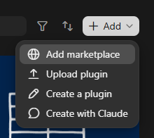
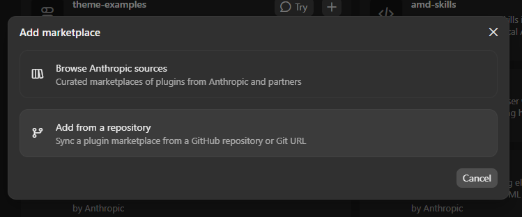
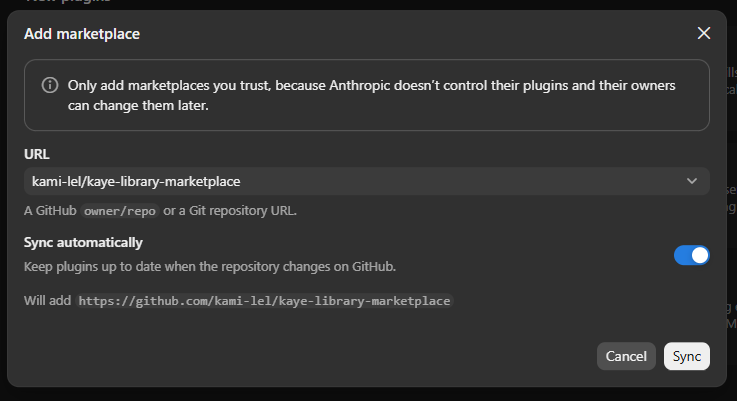
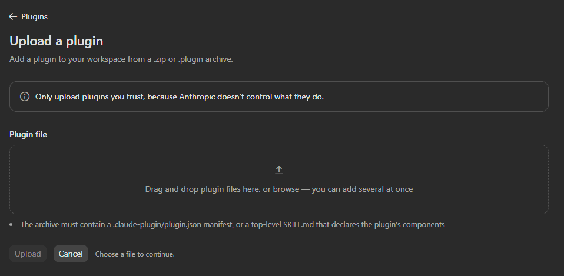

# kaye-library: Claude Usage Documentation

Install `kaye-library` in Claude Desktop or the Claude Code VS Code Extension: pick any one of the methods below.

<!--
TODO zh version of claude usage doc
-->

## for Claude Desktop

### ⓐ Add the Marketplace by URL

1. Click *Customize* in the sidebar.

   

2. Open the *Plugins* tab.

   

3. Click *Add* → *Add marketplace*.

   

4. Choose *Add from a repository*.

   

5. Type this in the *URL* field, then choose *Use "kami-lel/kaye-library-marketplace"*:

   ```text
   kami-lel/kaye-library-marketplace
   ```

   

6. Click *Sync*.

   


### ⓑ Upload the Release Zip

Download a ready-made plugin file, then upload it.

1. Download `kaye-library-VERSION-claude-desktop-plugin.zip` from the [GitHub Releases page](https://github.com/kami-lel/kaye-library/releases).
2. Upload it as in [Upload Plugin as Zip File](#upload-plugin-as-zip-file).


### ⓒ Build and Upload the Zip

Make the plugin file yourself, then upload it.

1. Build the zip:

   ```bash
   kaye-engine claude plugin -z
   ```

2. Upload `CONSUMER-claude-VERSION.zip` from the current directory, as in [Upload Plugin as Zip File](#upload-plugin-as-zip-file).


### Upload Plugin as Zip File

1. Click *Customize* in the sidebar.

   

2. Open the *Plugins* tab.

   

3. Click *Add* → *Upload plugin*.

   

4. Drop the zip into the dialog, or browse for it, then click *Upload*.

   


## for Claude Code VS Code Extension

### ⓐ Add the Marketplace by URL

<!-- TODO add screen caps of adding the marketplace by URL in the VS Code Extension -->

In the *Claude Code* panel, run:

```text
/plugin marketplace add kami-lel/kaye-library-marketplace
/plugin install kaye-library@kaye-library-marketplace
```

- Update: `/plugin marketplace update kaye-library-marketplace`
- Remove: `/plugin uninstall kaye-library@kaye-library-marketplace`

### ⓑ Run the One-Click Installer

1. Download the installer for your system from the [GitHub Releases page](https://github.com/kami-lel/kaye-library/releases), then run it:
   - Windows: extract `kaye-library-VERSION-claude-vsc-installer-Win.zip`, then double-click `Install.cmd`
   - Linux: run `bash kaye-library-VERSION-claude-vsc-installer-linux.run`
2. Restart VS Code.
3. Check the result, as in [Check the Result](#check-the-result).

- Update: run the new installer
- Remove: follow [Remove](#remove)

### ⓒ Run the Setup Command

1. Run:

   ```bash
   kaye-engine claude vs-code-extension
   ```

2. Restart VS Code.
3. Check the result, as in [Check the Result](#check-the-result).

- Update: run the command again
- Remove: follow [Remove](#remove)

### Check the Result

<!-- TODO replace w/ newer VS Code Extension screen caps if the panel UI changed -->

1. In the *Claude Code* panel, type `/` and choose *Manage plugins*.

   

2. Open the *Plugins* tab. Check that every plugin is listed under *Installed* as `PLUGIN@kaye-engine`, its toggle on.

   

3. Open the *Marketplaces* tab. Check that the `kaye-engine` marketplace is listed.

   

### Remove

1. Delete the folder `~/.claude/kaye-engine/`.
2. In `~/.claude/settings.json`, delete the `kaye-engine` entries under `extraKnownMarketplaces` and `enabledPlugins`.
