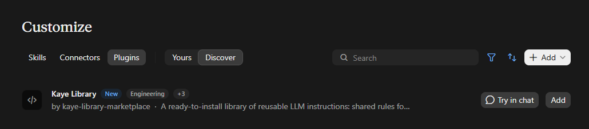
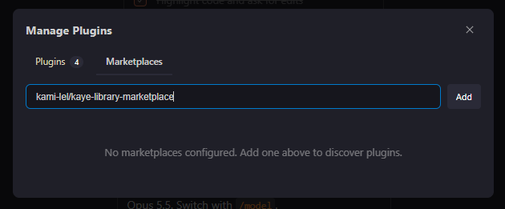
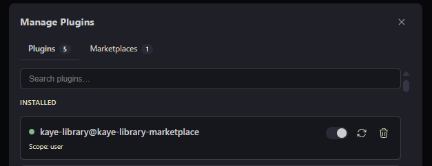

# kaye-library：Claude 使用文档

[English](claude-usage-doc.md) | 简体中文

在 Claude Desktop 或 Claude Code VS Code 扩展中安装 `kaye-library`：从下列方法中任选其一即可。

## 用于 Claude Desktop

在 Claude Desktop 中有 3 种安装方式：

### ⓐ 通过 URL 添加插件市场

1. 点击侧边栏中的 *自定义*。

   

2. 打开 *插件* 标签页。

   

3. 点击 *添加* → *添加插件市场*。

   

4. 选择 *从仓库添加*。

   

5. 在 *URL* 输入框中输入以下内容，然后选择 *使用 "kami-lel/kaye-library-marketplace"*：

   ```text
   kami-lel/kaye-library-marketplace
   ```

   

6. 点击 *同步*。

   

7. 在 *发现* 视图中，点击 *Kaye Library* 旁的 *添加*。

   


### ⓑ 上传发布版 Zip

下载现成的插件文件，然后上传。

1. 从 [GitHub Releases 页面](https://github.com/kami-lel/kaye-library/releases) 下载 `kaye-library-VERSION-claude-desktop-plugin.zip`。
2. 按 [上传插件 Zip 文件](#上传插件-zip-文件) 中的步骤上传。


### ⓒ 自行构建并上传 Zip

自己生成插件文件，然后上传。

1. 构建 zip：

   ```bash
   kaye-engine claude plugin -z
   ```

2. 按 [上传插件 Zip 文件](#上传插件-zip-文件) 中的步骤，上传当前目录下的 `CONSUMER-claude-VERSION.zip`。


### 上传插件 Zip 文件

1. 点击侧边栏中的 *自定义*。

   

2. 打开 *插件* 标签页。

   

3. 点击 *添加* → *上传插件*。

   

4. 将 zip 拖入对话框，或浏览选择该文件，然后点击 *上传*。

   


## 用于 Claude Code VS Code 扩展

在 Claude Code VS Code 扩展中有 4 种安装方式：任选其一，然后按 [检查已安装的插件](#检查已安装的插件) 进行验证。

### ⓐ 通过 URL 添加插件市场

1. 在 *Claude Code* 面板中输入 `/`，然后选择 *管理插件*。

   

2. 打开 *插件市场* 标签页。在输入框中输入以下内容，然后点击 *添加*：

   ```text
   kami-lel/kaye-library-marketplace
   ```

   

3. 确认 `kaye-library-marketplace` 已列出。

   

4. 打开 *插件* 标签页。在 *可用* 下，点击 `kaye-library` 旁的 *安装*。

   

5. 确认 `kaye-library@kaye-library-marketplace` 已列在 *已安装* 下。

   

6. 重启 VS Code。


### ⓑ 在 Windows 上运行一键安装程序

下载现成的安装程序，然后运行。

1. 从 [GitHub Releases 页面](https://github.com/kami-lel/kaye-library/releases) 下载 `kaye-library-VERSION-claude-vsc-installer-Win.zip`。
2. 解压后双击 `install.cmd`。
3. 重启 VS Code。
4. 按 [检查已安装的插件](#检查已安装的插件) 检查结果。


### ⓒ 在 Linux 上运行一键安装程序

下载现成的安装程序，然后运行。

1. 从 [GitHub Releases 页面](https://github.com/kami-lel/kaye-library/releases) 下载 `kaye-library-VERSION-claude-vsc-installer-linux.run`。
2. 运行：

   ```bash
   bash kaye-library-VERSION-claude-vsc-installer-linux.run
   ```

3. 重启 VS Code。
4. 按 [检查已安装的插件](#检查已安装的插件) 检查结果。


### ⓓ 运行安装命令

用一条命令自行安装。

1. 运行：

   ```bash
   kaye-engine claude vs-code-extension
   ```

2. 重启 VS Code。
3. 按 [检查已安装的插件](#检查已安装的插件) 检查结果。


### 检查已安装的插件

1. 在 *Claude Code* 面板中输入 `/`，然后选择 *管理插件*。

   

2. 打开 *插件* 标签页。确认 `kaye-library` 已列在 *已安装* 下，且开关已打开。

   

3. 打开 *插件市场* 标签页。确认 `kaye-engine` 已列出。

   
