# kaye-library：Claude 使用文档

[English](claude-usage-doc.md) | 简体中文

在 Claude Desktop 或 Claude Code 的 VS Code 扩展里安装 `kaye-library`，下面的方法任选一种即可。

## Claude Desktop

Claude Desktop 有 3 种安装方式：

### ⓐ 通过 URL 添加插件市场

1. 点击侧边栏里的 *自定义*。

   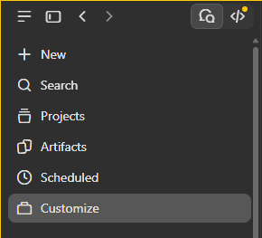

2. 打开 *插件* 标签页。

   

3. 点击 *添加* → *添加插件市场*。

   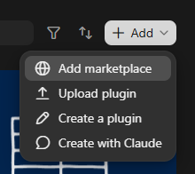

4. 选择 *从仓库添加*。

   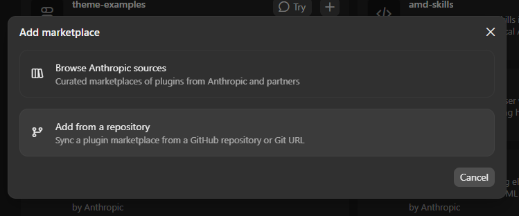

5. 在 *URL* 一栏填入下面的内容，然后选择 *使用 "kami-lel/kaye-library-marketplace"*：

   ```text
   kami-lel/kaye-library-marketplace
   ```

   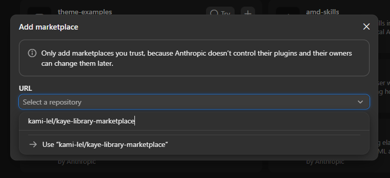

6. 点击 *同步*。

   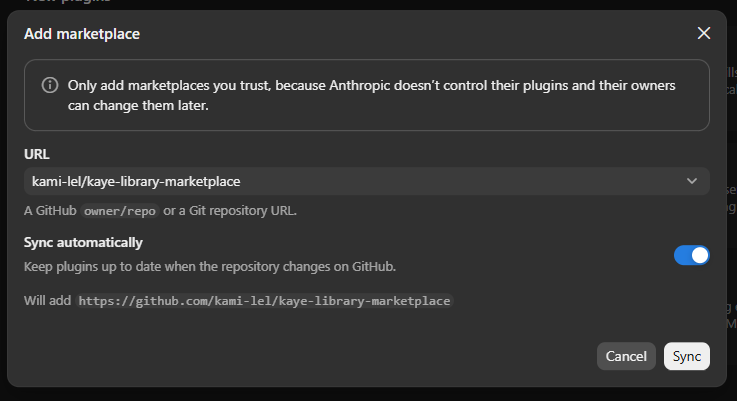

7. 在 *发现* 视图里，点击 *Kaye Library* 旁边的 *添加*。

   


### ⓑ 上传 Release 里的 Zip 包

下载现成的插件包，然后上传。

1. 到 [GitHub Releases 页面](https://github.com/kami-lel/kaye-library/releases) 下载 `kaye-library-VERSION-claude-desktop-plugin.zip`。
2. 按照 [上传插件 Zip 文件](#上传插件-zip-文件) 里的步骤上传。


### ⓒ 自己构建并上传 Zip 包

自己生成插件包，然后上传。

1. 构建 zip：

   ```bash
   kaye-engine claude plugin -z
   ```

2. 按照 [上传插件 Zip 文件](#上传插件-zip-文件) 里的步骤，上传当前目录下生成的 `CONSUMER-claude-VERSION.zip`。


### 上传插件 Zip 文件

1. 点击侧边栏里的 *自定义*。

   

2. 打开 *插件* 标签页。

   

3. 点击 *添加* → *上传插件*。

   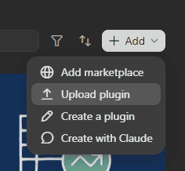

4. 把 zip 拖进对话框，或者点击浏览选中文件，然后点击 *上传*。

   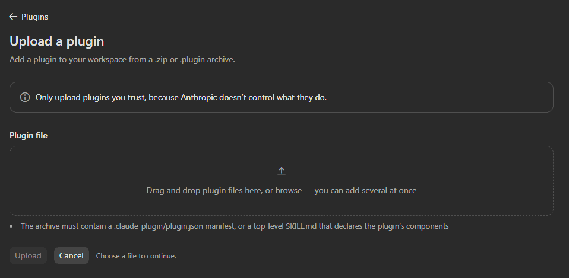


## Claude Code VS Code 扩展

VS Code 扩展有 4 种安装方式：任选一种，装好后按 [检查已安装的插件](#检查已安装的插件) 确认一下。

### ⓐ 通过 URL 添加插件市场

1. 在 *Claude Code* 面板里输入 `/`，选择 *管理插件*。

   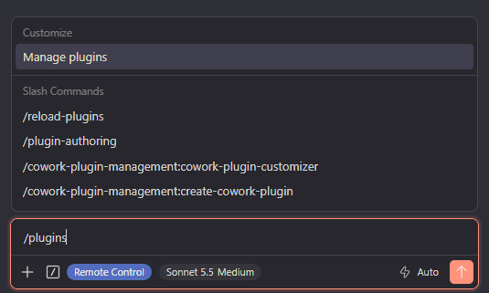

2. 打开 *插件市场* 标签页，在输入框里填入下面的内容，然后点击 *添加*：

   ```text
   kami-lel/kaye-library-marketplace
   ```

   

3. 确认列表里出现了 `kaye-library-marketplace`。

   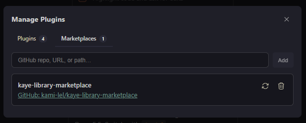

4. 打开 *插件* 标签页，在 *可用* 下点击 `kaye-library` 旁边的 *安装*。

   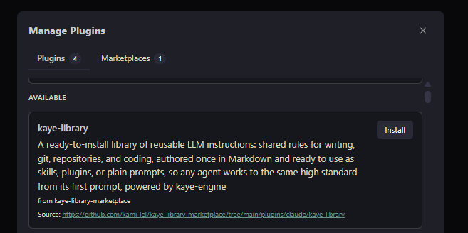

5. 确认 *已安装* 下出现了 `kaye-library@kaye-library-marketplace`。

   

6. 重启 VS Code。


### ⓑ Windows 一键安装

下载现成的安装包，直接运行。

1. 到 [GitHub Releases 页面](https://github.com/kami-lel/kaye-library/releases) 下载 `kaye-library-VERSION-claude-vsc-installer-Win.zip`。
2. 解压，双击 `install.cmd`。
3. 重启 VS Code。
4. 按 [检查已安装的插件](#检查已安装的插件) 确认安装结果。


### ⓒ Linux 一键安装

下载现成的安装包，直接运行。

1. 到 [GitHub Releases 页面](https://github.com/kami-lel/kaye-library/releases) 下载 `kaye-library-VERSION-claude-vsc-installer-linux.run`。
2. 运行：

   ```bash
   bash kaye-library-VERSION-claude-vsc-installer-linux.run
   ```

3. 重启 VS Code。
4. 按 [检查已安装的插件](#检查已安装的插件) 确认安装结果。


### ⓓ 用命令安装

一条命令搞定。

1. 运行：

   ```bash
   kaye-engine claude vs-code-extension
   ```

2. 重启 VS Code。
3. 按 [检查已安装的插件](#检查已安装的插件) 确认安装结果。


### 检查已安装的插件

1. 在 *Claude Code* 面板里输入 `/`，选择 *管理插件*。

   

2. 打开 *插件* 标签页，确认 *已安装* 下有 `kaye-library`，并且开关已经打开。

   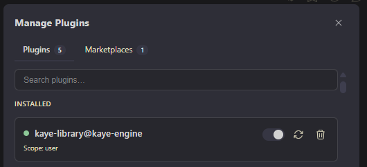

3. 打开 *插件市场* 标签页，确认列表里有 `kaye-library`。

   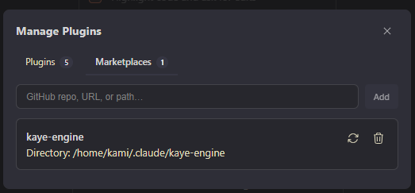
