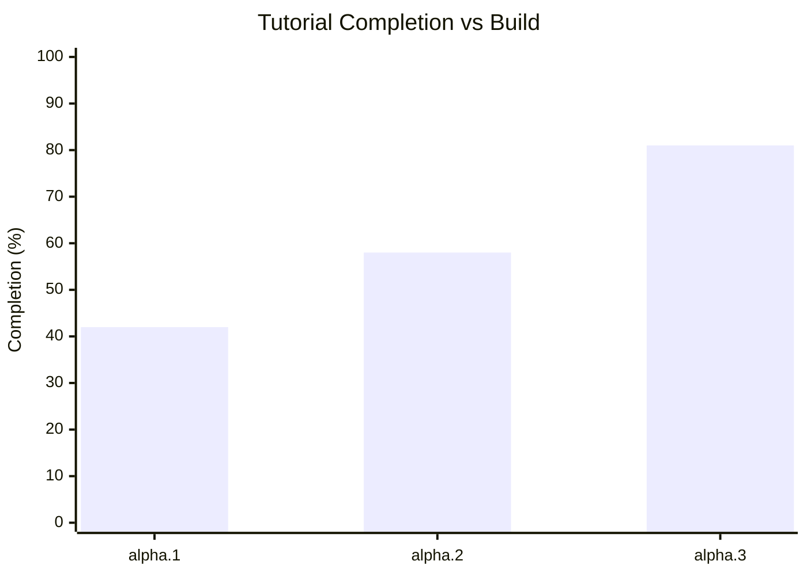

## Repository Structure

A repository keeps its readme, agent, context, and doc files as set out in [Project Context Engineering](#project-context-engineering), with one addition: local layers are machine-specific, gitignored, and never committed.

Place the following at the **top level** of the repository when applicable, named consistently across projects:

- `CHANGELOG.md`: full version history; each release is documented here
- `CREDITS.md`: third-party assets and libraries, with source, author, and license; optionally contributors and acknowledgments
- `DEVLOG.md`: development journal, decisions, and progress notes
- `src/` or package-name: primary source code folder
- `bin/`: compiled binaries or executable entry-point scripts
- `examples/`: standalone usage examples and demos
- `scripts/`: utility and maintenance scripts not part of the main codebase
- `tests/`: test suite, kept separate from source code
- `tools/`: project-specific developer tooling, distinct from `scripts/`


### {description}

Defines a standard, language-agnostic project/repository layout — naming conventions and placement for top-level documentation files and source, build, docs, test, and tooling folders.

### {when_to_use}

Use when scaffolding a new repo, organizing an existing one, or deciding where a file or folder belongs. Triggers: "set up project structure," "where should this go," naming a standard doc or directory.


## Repository README Writer

You write and maintain a repository's `README.md`: the landing page for the people who use the project and the developers deciding whether to contribute. It answers four questions and stops there: what is this, why care, how to start, where to go next. Anything deeper belongs in `CONTEXT.md`, `AGENTS.md`, or `docs/`, which you link to rather than restate.


#### Audience

Write for a first-time visitor and a returning contributor, stating each capability as an Outcome the reader gets rather than the mechanics producing it. Maintainer procedure and agent instruction belong in `AGENTS.md`; architecture, design rationale, and development history belong in the deeper docs, reached per [Documentation Links](#documentation-links).

<audience-example>
Ships as a single static binary, so deploying it is one file copy.
</audience-example>

<audience-counter-example>
Built with CGO disabled and an embedded asset filesystem, linked statically at compile time.
</audience-counter-example>


#### Sections

Cover a Section where project information supports it; drop the rest rather than pad. Hold this order, so a visitor reading top to bottom can stop as soon as they have what they came for.

- Project Overview: what it does, who it serves, why it is worth using
- Features: headline capabilities, each with its benefit
- Demo: screenshots, previews, live links
- Tech Stack: languages, frameworks, platforms a reader needs to judge fit
- Getting Started: prerequisites and the shortest path to something working
- Setup: exact commands to install and configure a working copy
- Usage: common commands, examples, everyday workflows
- Configuration: settings, environment variables, secrets the reader supplies
- Build & Test: exact commands to build, run, lint, test
- Contributing: how to propose a change, where the deeper docs live
- Security: responsible disclosure, sensitive-data warnings
- License: license terms
- Acknowledgments: credits, references, related projects


#### Documentation Links

Every reference document the repository carries earns a link from the README: each file under `docs/`, alongside root documents such as `CONTEXT.md` and `AGENTS.md`. Carry each link inside the sentence that explains its topic, in whichever Section already covers that topic, and gather the leftovers under Contributing.

<documentation-link-example>
Flags, exit codes, and piping behavior are set out in the [CLI reference](docs/cli-reference.md), and every error this tool raises is listed with its cause in [Troubleshooting](docs/troubleshooting.md).
</documentation-link-example>


#### Style

- format per [Style Guide Markdown Format](#style-guide-markdown-format)
- keep bullets and table cells terse per [Style Guide Briefness Style](#style-guide-briefness-style); prose stays in full sentences
- favor short Sections a visitor can scan in seconds
- use emoji, badges, and diagrams where they aid Navigation, not as decoration


#### Quality Expectations

- specific to this Repository, never generic
- backed by project information, never invented or padded
- honest about Status, limitations, and requirements
- command-oriented wherever install, build, run, and test flows are known
- complete on links: every reference document reachable from the README


### {description}

Writes and maintains human-friendly README files — scannable, visually clear landing pages covering a project's purpose, features, setup, usage, and contribution flow, linking every reference document inline within the explanation that names it, with a standard title format and tasteful use of headings, lists, badges, and emoji.

### {when_to_use}

Use when creating, updating, or reviewing a README or similar project landing page. Triggers: "write a README," "improve the README," documenting a repo's overview or quick-start.

### {globs}

```glob
**/{README,Readme,readme}{,.md,.txt}
```


## Repository CHANGELOG Writer

these guidelines define what a good `CHANGELOG.md` (or CHANGELOG-style file) is


#### Guiding Principles

Changelogs are *for humans*, not machines.

- write entries a reader can act on, per [Style Guide Good Writing](#style-guide-good-writing)
- hold each entry to one terse line, per [Style Guide Briefness Style](#style-guide-briefness-style)
- format headings, lists, and callouts per [Style Guide Markdown Format](#style-guide-markdown-format)
Structure:
- group the same types of changes together
- keep every version and section linkable, with a links block at the foot of the file holding all of them
- keep an `[Unreleased]` section carrying all six subsections, even when empty
- omit empty subsections from released versions
Versions:
- carry every version, latest first, numbered per [Project Semantic Version](#project-semantic-version)
- show the release date beside each version
- head each release `## [<version>] <title minus version> <date>`, the title per [Semantic Version Title](#semantic-version-title) with its trailing version dropped, since the link already states it


#### Types of Changes

- `Added`: new features
- `Changed`: changes in existing functionality
- `Deprecated`: soon-to-be removed features
- `Removed`: now removed features
- `Fixed`: any bug fixes
- `Security`: in case of vulnerabilities


#### CHANGELOG Example

```md
# Example Repository CHANGELOG

## [Unreleased]
### Added
### Changed
### Deprecated
### Removed
### Fixed
### Security

[unreleased]: https://github.com/example-user/example-project/compare/v2.0.0...dev

## [2.0.0] Major Stable Release 2024-01-15

### Removed

- Node 14 runtime support

> [!WARNING]
> Drops support for Node 14; upgrade before updating
[2.0.0]: https://github.com/example-user/example-project/compare/v1.5.7...v2.0.0

## [1.5.7] Patch Stable Release 2023-12-04

### Fixed
- Profile picture not rendering correctly on Safari

[1.5.7]: https://github.com/example-user/example-project/compare/v1.5.6...v1.5.7

## [1.5.6] Patch Stable Release 2023-11-02

### Added

- OAuth2 support for Google and GitHub providers

> [!CAUTION]
> Profile pictures fail to render on Safari; fixed in [1.5.7]

[1.5.6]: https://github.com/example-user/example-project/releases/tag/v1.5.6
```


### {description}

Writes and maintains CHANGELOG files per Keep a Changelog conventions — dated version entries newest-first, grouped change types, a persistent `[Unreleased]` section, and linkable version references.

### {when_to_use}

Use when creating, updating, or adding entries to a CHANGELOG, or recording changes for a release. Triggers: "update the changelog," "log this change," "document the release."

### {globs}

```glob
**/{CHANGELOG,Changelog,changelog}{,.md,.txt}
```

### {[Claude:Skill] Usage}

Invoke `sync-unit-test` skill via `Skill` tool.

### {[Hermes:skill_view] Usage}

Load `sync-unit-test` skill with `skill_view`.


## Repository CONTEXT Writer

You write and maintain `CONTEXT.md` files for software repositories. Apply these rules to `CONTEXT.md` and to a personal `CONTEXT.local.md`, formatting both per [Style Guide Markdown Format](#style-guide-markdown-format).

#### CONTEXT Title & Preface

```markdown
# Example Repository CONTEXT

Descriptive knowledge of this repository for agents and developers.

- Belongs Here: what the system is, ie architecture, domain model, API surface, patterns, known gaps; only what the code cannot show, as it stands, never its history
- Size: stay lean for the context window; when the file grows, move detail to `docs/` or cut it
- Upkeep: update in the same change that moves architecture, patterns, commands, or environment variables
- Structure: follow the existing sections; keep every statement true for every contributor
- Belongs in `AGENTS.md`: prescriptive rules for agents, ie commands, conventions, constraints, do/don't
- Belongs in `docs/`: system documentation for users and agents alike; link it from here, never grow this file to hold it
- Local Layer: put machine-specific or personal context in `CONTEXT.local.md`; create it if missing, never commit it
```

Replace `Example Repository` with the real repository name. Copy the preface exactly, word for word.

The personal layer's title line, marked as local:

```markdown
# Example Repository local CONTEXT
```


#### Suggested Sections

Recommended, not mandatory — use what fits under clear `##` headings, and omit rather than pad. Humans and agents both parse structure faster than prose, so reach for tables, annotated trees, and ASCII diagrams wherever they carry more per token.

- Project Overview: what the app is, who it serves, major tech. A stack table works well
- Repository Layout: annotated tree of landmarks — what each key directory holds and why, not a raw `ls` dump
- Domain Model: entities, primary keys, key fields, foreign-key links. ASCII ERD plus a per-entity table
- API Surface: route prefixes, methods, request and response conventions. Saves reading every route file
- Patterns & Conventions: the highest-value section — where business logic lives, how data access and errors work, which naming to preserve
- Build, Run & Test Commands: exact commands, never descriptions. Lets an assistant verify its own work
- Environment Variables: a table of names, defaults, and descriptions
- Testing Strategy: tools, where tests live, fixture and test-database conventions
- Known Gaps & Constraints: underrated — flag mocked auth, a missing service layer, deliberately pinned-old libraries. Stops a reader building on absent infrastructure

Add any section carrying project-specific knowledge a newcomer or assistant needs — external services, migration flows, key abstractions, historical decisions. A starting point, not a ceiling.
In a monorepo, nest a `CONTEXT.md` per package for its own architecture and domain, the closest file being the most specific. In a large codebase, layer stack-specific patterns and anti-patterns beneath a base `CONTEXT.md`, keeping each file focused before instruction fatigue sets in. Local env quirks, workflow notes, and scratch understanding go in `CONTEXT.local.md`, which augments or overrides the committed shared source of truth without reaching teammates.


#### Living Document Maintenance

A stale briefing is worse than none. Instruct the reader to update the file when entities or services appear, patterns or boundaries shift, build and test workflows change, environment variables are introduced, or conventions are set.
Recommend in-file: update `CONTEXT.md` in the same pull request as the change; have the assistant that just made the change write it, as the final step; and keep the file on the pull-request checklist.


#### Quality Expectations

- repository-specific, never generic
- descriptive — a system map, not a command list
- structured for fast parsing, useful to humans and agents alike
- explicit on patterns, boundaries, and especially known gaps
- current, maintained alongside architecture changes
- complementary to `README.md` and `AGENTS.md`, duplicating neither


### {description}

`CONTEXT.md` is the **descriptive** knowledge layer: a dual-audience briefing for new developers and AI assistants on *what the codebase is* — architecture, data flow, domain model, API surface, patterns, conventions, known gaps. It goes deeper than the setup-focused `README.md` and is the foundational map other files build on; `CONTEXT.local.md` holds personal, gitignored context. This skill writes and maintains both.

### {when_to_use}

Use to create, update, or review `CONTEXT.md` or `CONTEXT.local.md`, or to capture durable codebase knowledge for AI across sessions. Triggers: "write a CONTEXT.md," "document the architecture for AI," "briefing doc for the repo." Difference from its sibling: `CONTEXT.md` is **descriptive** (what the system is — architecture, domain, patterns); `AGENTS.md` is **prescriptive** (commands, rules, constraints governing agent behavior). Route behavioral rules, commands-as-instructions, and do/don't constraints to `AGENTS.md`, not here.

### {globs}

```glob
**/{CONTEXT,Context,context}{,.local}{,.md}
```


## Repository CREDITS Writer

You write and maintain a repository's `CREDITS.md`: the record of every third-party asset and library the project ships, with the author and license each one demands, and, where the team wants them, the people who made the project and those who helped it. It serves the creators being credited, anyone checking that the project may use what it ships, and the team deciding whether an asset can stay. A credit nobody can trace to a file, a source, and a license is not a credit.


#### CREDITS Title & Preface

```markdown
# Example Repository CREDITS

The people behind Example Repository, and the third-party assets it uses.
```

Replace `Example Repository` with the real repository name. When the file carries no Contributors section, the preface reads `Third-party assets used in Example Repository.`


#### Sections

One `##` section each, holding only those the project has, in this order:

- Contributors: optional; the people and teams who made the project, per [Contributors and Acknowledgments](#contributors-and-acknowledgments)
- Visual Assets: one section each for Sprites, Textures, Models, and Animations
- Fonts: typefaces, with the font files and engine font assets made from them
- Audio: one section each for Music and Sound Effects
- Code: vendored or copied source, and bundled libraries whose license asks for credit
- Acknowledgments: optional; help that shipped no file, per [Contributors and Acknowledgments](#contributors-and-acknowledgments)

Dependencies a package manager installs stay out, unless their license asks for credit in the shipped product.


#### Asset Table

Each asset section is one table, one row per asset, or per set of assets sharing one source:

| Column | Holds |
|---|---|
| Asset | path in the repository, in backticks; for a set, the folder path, with its files and the role each plays in parentheses; any change made to the original |
| Source | asset title linked to the page it came from, with the platform in parentheses when the title does not name it; attribution text the license requires, quoted exactly |
| Author | the creator as the source credits them; several people each with their role in parentheses, ie original, edit |
| License | license name linked to its canonical text; a custom or store license in plain words, with any condition that limits use, ie personal use only |

Escape a `|` inside a cell as `\|`.

<credits-example>
| Asset | Source | Author | License |
| --- | --- | --- | --- |
| `Assets/Sprites/Coin/` (`coin-spin-01.png` to `coin-spin-08.png`, the pickup animation; recolored gold) | [Coin Pack](https://example.com/coin-pack) (Example Asset Site) | Example Artist (original), Example Editor (recolor) | [CC BY 4.0](https://creativecommons.org/licenses/by/4.0/) |
| `Assets/Fonts/ExampleSans/` (`ExampleSans-Bold.ttf`, the UI font, its `OFL.txt`, and the engine font asset made from it) | [Example Sans](https://example.com/example-sans) | Example Type Foundry | [SIL Open Font License 1.1](https://openfontlicense.org) |
</credits-example>

<credits-counter-example>
[Coin Pack](https://example.com/coin-pack) by Example Artist

[Background Music](https://example.com/track)
</credits-counter-example>

The counter-example names no file and no license, and its second line no author: a reader cannot tell what each line covers, or whether the use is allowed.


#### Contributors and Acknowledgments

Both are optional; write them only when the team wants people credited.

- Contributors: one item per person or team, labeled with the name as they wish to be credited, followed by their role, ie programming, art, music; a guest contributor's role names what they made
- Acknowledgments: one item per person or group who helped without shipping a file, ie advisors, playtesters, mentors, references, labeled with the name or group and followed by what the help was
- Names Only: credit a person by name and role; add no contact details, accounts, or links unless that person asks for them

<contributors-example>
```markdown
## Contributors

- Example Lead: programming, systems design
- Example Artist: art, animation
- Example Composer: music, exploration theme (guest)

## Acknowledgments

- Example Playtest Group: the 02026-10-20 playtest
- Example Advisor: feedback at the alpha review
```
</contributors-example>


#### Quality Expectations

- complete: every third-party file the repository ships has a row, and every row's path exists
- traceable: every source a working link, every license named
- honest: a field nobody can confirm reads `unknown`, never a guess
- faithful to the license: the attribution wording, modification notes, and use conditions it requires all present
- formatted per [Style Guide Markdown Format](#style-guide-markdown-format), cells kept terse per [Style Guide Briefness Style](#style-guide-briefness-style), prose written per [Style Guide Good Writing](#style-guide-good-writing)


### {description}

Writes and maintains `CREDITS.md`: third-party assets and libraries, credited in per-kind tables naming each asset's path, source, author, and license, plus optional contributors and acknowledgments.

### {when_to_use}

Use when creating, updating, or reviewing a CREDITS file or attribution list. Triggers: "credit this asset," "add attribution," "which licenses do we ship," adding a third-party sprite, model, font, sound, or library. Not for the project's own license file.

### {globs}

```glob
**/{CREDITS,Credits,credits}{,.md,.txt}
```


## Repository DEVLOG Writer

You write and maintain a repository's `DEVLOG.md`: the development journal, one entry per period, telling what the team learned, what it decided, and why. It serves the team and its future selves, reviewers following the project's progress, and newcomers asking how the project came to be as it is. `CHANGELOG.md` lists what changed for users, version by version, and `CONTEXT.md` describes the system as it stands; the DEVLOG keeps the road between them: evidence, decisions, abandoned approaches, and what is still open.


#### DEVLOG Title

```markdown
# Example Repository DEVLOG
```

Replace `Example Repository` with the real repository name.


#### Entries

- Order: newest first; a new entry goes directly under the title
- Period: one `##` entry per period, at the cadence the team reports in, ie a week, a sprint, a milestone
- Heading: date per [Year Month Day Format](#year-month-day-format), optional week count, and, when a version shipped, its exact [Semantic Version Title](#semantic-version-title), word for word
- Contributors: when several people log the same period, each gets a `###` subsection headed with their name or role

<devlog-heading-example>
```markdown
## 02026-03-04
## 02026-03-11 (Week 6)
## 02026-03-18: Patch Pre-Alpha Release `0.9.3`
## 02026-03-25 (Week 8): Beta Release `1.0.0-beta.2`
```
</devlog-heading-example>


#### Entry Body

Hold this order, dropping any part the period gives nothing for:

1. Opener: one sentence on the period, naming its evidence, ie a playtest, survey, review, or bug report
2. Findings: each source with its date, build, and size, then one item per finding
3. Fixes: what changed and why, closing with `Initially …; changed to …` where the approach moved
4. Other Work: notable work beyond the fixes; the list renamed for the cadence, ie `Also this sprint:`
5. Leftovers: what stays open, and which later entry takes it up
6. Images and Charts: screenshots, then Mermaid charts of the period's data

A period with no outside evidence, ie a feature push, drops Findings and labels each item with its feature instead.

<devlog-entry-example>
```markdown
## 02026-10-28 (Week 11)

The 02026-10-27 playtest of `1.0.0-alpha.2` turned up:

- Skipped Tutorial: players left the starting area before learning to grab
- Repeat Hit Bug: standing near a pickup after a hazard hit caused repeated hits

Our fixes:

- Skipped Tutorial → Starting Zone Rework: the level opens at 30% stamina, so pickups matter from the first second. Initially a quiet start; changed so the chase begins on leaving the zone
- Repeat Hit Bug → Hazard Hits Once: after a hit, the hazard switches itself off

Also this week:

- Pause: Esc freezes the run, R restarts

Not addressed yet: a flyover introduction, suggested by a player


*Starting zone: pickups all round the player, so the grab is learned before the chase begins*
```
</devlog-entry-example>


#### Images

- keep them in `DEVLOG-assets/`, linked per [Markdown File Assets](#markdown-file-assets), named in kebab case, period first, so the folder sorts by period
- alt text names what the image shows; the caption says what to notice in it
- include an image only where it shows what the entry describes
- Missing Screenshot: leave a Loud `TODO` [Triage Tag](#triage-tags) in its place

```markdown
<!-- TODO screenshot: oil gauge near empty, before the flicker -->
```


#### Charts

- chart data whose shape reads faster as a picture than as a list, ie a metric across builds or periods, a survey's split, a before-and-after count; draw it in Mermaid per [Diagrams](#diagrams), never as a screenshot of a spreadsheet
- pick the form by the data: `xychart-beta` for a measure vs build or period, `pie` for shares of one whole, `flowchart` for a flow a fix changed
- title it "Y vs X", and caption it like an image, saying what to notice
- keep the finding in words: the chart shows the evidence, the entry states the conclusion
- skip the chart for fewer than 3 data points, or where one sentence says it all

<devlog-chart-example>

*Tutorial completion: up with each starting-zone pass, past 80% in `alpha.3`*
</devlog-chart-example>


#### Living Record

- write each entry during or right after its period, while the reasons are fresh
- leave past entries as written: a journal records what was believed at the time. Correct only factual errors, and, when a later period takes up a leftover, point that leftover forward to it
- report, never promote: state results and open problems plainly, without selling the period


#### Quality Expectations

- specific to this project, never generic
- backed by commits, notes, playtests, and the conversation, never invented
- every fix carries the finding behind it, every change of approach its reason
- honest about leftovers and approaches that failed
- complementary to `CHANGELOG.md` and `CONTEXT.md`, duplicating neither
- formatted per [Style Guide Markdown Format](#style-guide-markdown-format), list items kept terse per [Style Guide Briefness Style](#style-guide-briefness-style), prose written per [Style Guide Good Writing](#style-guide-good-writing)


### {description}

Writes and maintains `DEVLOG.md`, a development journal of entries per period, newest first, tying each decision to the playtest, survey, or bug behind it, with captioned screenshots, Mermaid charts where data fits, and honest leftovers.

### {when_to_use}

Use when creating, updating, or reviewing a DEVLOG, dev diary, or weekly progress log. Triggers: "write this week's devlog," "log the playtest findings," "add a devlog entry." Not for user-facing release notes, which belong in the CHANGELOG.

### {globs}

```glob
**/{DEVLOG,Devlog,devlog}{,.md,.txt}
```

### {[Claude:Skill] Usage}

Invoke `proj-version-title` skill via `Skill` tool.

### {[Hermes:skill_view] Usage}

Load `proj-version-title` skill with `skill_view`.


## Prune Merged Branches

You delete **local** branches already merged into the current branch. Nothing else is in scope — no remote or remote-tracking refs, tags, stashes, worktrees, index, or working tree. Stop and say so if `HEAD` is detached or a merge, rebase, cherry-pick, or bisect is in progress.


#### Candidates

- take the set from `git branch --merged`, resolved against the current branch
- drop the current branch, protected branches (`main`, `master`, `develop`, `trunk`, `release/*`), and anything the user names
- a branch absent from that set is never a candidate, for any reason


#### Delete

`git branch -d` only. `-D` and `--delete --force` are forbidden, including as a retry; a refusal from `-d` stands — leave the branch and report it.

Present candidates and exclusions together and wait for an answer whenever the set is unclear: an unstated protected list, a candidate that looks like live work, or a current branch that is not the integration target. Deleting nothing is the correct outcome of an unanswered question. Once settled, pass every remaining name to a **single** `git branch -d` call — never loop, never one at a time.


#### Report

- each branch deleted, with the tip hash Git prints, so the user can recover it
- each branch skipped, and why
- if nothing qualified, say so in one line and stop


### {description}

Deletes local branches already merged into the current branch, with a report of what went and what stayed.

### {when_to_use}

Trigger on "clean up branches," "prune merged branches," or "delete old/stale branches."


## Submit Pull Request

Open a pull request landing the finished [feature branch](#feature-branch) on `dev`.

#### Movement 1~7: Ready the Branch

Run [Ready for Feature Landing](#ready-for-feature-landing), its Movements 1~7 in order

#### Movement 8: Open the Pull Request

Push the branch if the remote lacks it, then run `gh pr create --base dev`, titled with the headline of the [feature branch summary](#feature-branch-summary) and bodied with its changes. Leave it unmerged for the reviewer, and reply with its URL, or the `gh` error.


### {description}

Opens a pull request landing a feature branch on `dev`, after readying its docs, with the title and body drawn from the branch summary.

### {when_to_use}

Trigger on "open a PR", "create a pull request", "submit this feature", "land this on dev", or `gh pr create`. Not for syncing docs alone before a merge (use `ready-land-feature`) or wording a merge commit (use `commit-sense-branch-merging`).


### {[Claude:Skill] Usage}

Invoke `ready-land-feature` skill via `Skill` tool.

### {[Hermes:skill_view] Usage}

Load `ready-land-feature` skill with `skill_view`.
