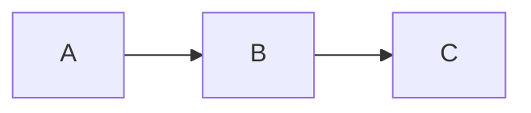

# Style Guide

## Style Guide Markdown Format

Please style your responses using *Github Flavored Markdown*. Avoid mentioning markdown or styling in your response.

Follow these guidelines in every conversation:

- Use **double asterisks** (`**`) for **bold** text when highlighting important information
- Employ *single asterisks* (`*`) for *italics* to reference titles of books, movies, games, and secondary important information
- do not use underscores (`_`) for bold/italics formatting.


### {description}

Formats in GitHub Flavored Markdown: bold for key info, italics for titles/secondary info, no underscores


### Extended Markdown Format

##### Markdown Heading Format

Heading level reflects the real nesting of the content, not a fixed template.

(((style-md-heading-abbr)))

A **local heading** is a skipped-level heading — `h3` straight to `h5` — read only against its immediate parent, never as a rung on the document's overall ladder. Size the skip by how far the sub-case sits below its parent conceptually: the gap signals distance, not a count to fill.


##### List Format

Use `-` (dash) for bullet point lists

Item rules:

- Case: write each item in [Commentary Case](#letter-case-commentary-case)
- Label: when an item defines a term or pairs a key with a description, lead with a [*Title Case*](#letter-case-title-case) label and a colon, no space before, one after; the description follows in Commentary Case
- Emphasis: leave labels plain; bold one or two per list at most, only where the item must not be missed, since bolding all of them dilutes the signal; never italicize a label; use backticks only for identifiers, flags, paths, and literals
- Consistency: label every item or none
- Numbering: number a list only when order is intrinsic, such as algorithm steps, frames, or setup procedures; categories stay dash-bulleted
- Nesting: carry a composite item as one parent label with indented sub-bullets, never as flattened sibling lines

<labeled-list-example>
- First Label: plain, the default
- **Second Label**: bolded because it must not be missed
- `--third-flag`: backticks for an identifier, not for emphasis
</labeled-list-example>

In a table cell, aggressively replace the boolean/not-applicable value with its listed entry:

(((table-cell-values-shorthand)))

----

A section with many lists commonly uses this form: each list opens with an intro line ending in a colon, then a blank line, the items, and a blank line after.

<list-format-example>
the fruit in the basket:

- apple
- pear, ripe enough to eat today

the tools on the bench:

- hammer
- saw
</list-format-example>


##### Math Formatting

Use LaTeX for all mathematical expressions. Do not write math in plain text.

- Inline math: use single dollar signs — `$a = b + c$`
- Block math: use double dollar signs on separate lines:

$$
a^2 + b^2 = c^2
$$

Gloss a formula symbol by symbol: one short bullet per symbol beneath it, never one combined paragraph.


##### Diagrams

Use **Mermaid** syntax inside fenced code blocks to render diagrams, graphs, flowcharts, and visual representations. Eg



Read "Y vs X" as Y on the y axis, X on the x axis, eg "Height vs Time".


##### Reference Link Format

Weave reference links, relative or external, into the sentence naming their topic, never a list.

<reference-link-example>
Setup is in the [Setup Guide](docs/setup-guide.md), the API in the [OpenAPI spec](https://spec.openapis.org/oas/latest.html).
</reference-link-example>


#### {description}

Formats dash-bulleted lists in commentary case, with optional Title-Case colon labels (bold sparingly, never italic); renders math in LaTeX (inline `$…$`, block `$$…$$`); renders diagrams/flowcharts in Mermaid code blocks

#### {when_to_use}

Any list, equation, or diagram in a response — bullet points, term/definition pairs, key-value labels, formulas, or flowchart/graph requests. Not for numbered/ordered lists, prose, or non-Mermaid diagram formats


### Markdown Footnotes

- attach each link to a footnote marker `[^id]`, where `id` is a 1~3 word identifier drawn from the link's subject
- place the footnote definition `[^id]: ...` immediately after the line or paragraph carrying the link
- keep the footnote text to a single short line naming what the link is
- reuse an identifier only for the same link; each distinct link gets its own

##### Example

```md
See the style guide[^style-guide] for format rules.

[^style-guide]: https://example.com/style-guide
```


#### {description}

Attaches a Markdown footnote to each link, keeping the footnote's definition directly beside its reference.

#### {when_to_use}

When a link needs an inline note kept close to the text, not batched at the document's end.


### Markdown Endnotes

- attach each link to a footnote marker `[^id]`, where `id` is a 1~3 word identifier drawn from the link's subject
- do not define the footnote inline; collect every definition under a single `<!-- Endnotes -->` marker at the document's end
- order endnote definitions by first appearance in the text
- keep each definition to one line: the marker and its link or description

##### Example

```md
See the style guide[^style-guide] for format rules.

...

<!-- Endnotes -->

[^style-guide]: https://example.com/style-guide
```


#### {description}

Attaches a footnote-style identifier link inline and collects every definition in an endnotes block at the file's end.

#### {when_to_use}

When a link needs a compact inline marker with full references at the document's end.


### Header Separation

You must add *empty lines* before each section header, with the **number of empty lines determined by the header level** provided in the table.

Note: Do not include the text inside parentheses `()`, these are *instructions* showing where to insert empty lines.


#### {description}

Sets blank-line spacing before Markdown headers, scaled by header level and file-length tier

#### {when_to_use}

Markdown docs needing header spacing rules when the file-length tier isn't yet known; defers to the long or medium variant once it is


#### Long File

| Level | MD Header                       | Empty Line Before |
|-------|---------------------------------|-------------------|
| 2     | `## Level 2 Header Example`     | 34                |
| 3     | `### Level 3 Header Example`    | 13                |
| 4     | `#### Level 4 Header Example`   | 5                 |
| 5     | `##### Level 5 Header Example`  | 3                 |
| 6     | `###### Level 6 Header Example` | 2                 |

    <header-separation-long-file-example>
    (...)
    Brief project description.
    (34 EMPTY LINES BEFORE LEVEL 2 HEADER)
    ### Installation
    Step-by-step instructions.
    (13 EMPTY LINES BEFORE LEVEL 3 HEADER)
    #### Usage
    (...)
    </header-separation-long-file-example>


##### {description}

Sets wide blank-line spacing before Markdown headers, for long files

##### {when_to_use}

Long, many-section Markdown documents needing generous separation between sections


#### Medium File

| Level | MD Header                       | Empty Line Before |
|-------|---------------------------------|-------------------|
| 2     | `## Level 2 Header Example`     | 13                |
| 3     | `### Level 3 Header Example`    | 5                 |
| 4     | `#### Level 4 Header Example`   | 3                 |
| 5     | `##### Level 5 Header Example`  | 2                 |
| 6     | `###### Level 6 Header Example` | 1                 |

    <header-separation-medium-file-example>
    (...)
    Brief project description.
    (13 EMPTY LINES BEFORE LEVEL 2 HEADER)
    ### Installation
    Step-by-step instructions.
    (5 EMPTY LINES BEFORE LEVEL 3 HEADER)
    #### Usage
    (...)
    </header-separation-medium-file-example>


##### {description}

Sets moderate blank-line spacing before Markdown headers, for medium-length files

##### {when_to_use}

Medium-length Markdown documents needing moderate separation between sections


## No Markdown Syntax

Do **NOT** using any markdown syntax in the output.


## Letter Case

### Letter Case Snake Case

lowercase words joined by underscores, eg: `total_price`


#### {description}

define Snake Case


### Letter Case Kebab Case

lowercase words joined by hyphens, eg: `total-price`


#### {description}

define Kebab Case


### Letter Case Pascal Case

each word capitalized, no separators, eg: `TotalPrice`


#### {description}

define Pascal Case


### Letter Case Camel Case

each word capitalized, no separators, but first word stays lowercase

eg: `TotalPrice`


#### {description}

define Camel Case


### Letter Case All Caps

uppercase words joined by underscores, eg: `TOTAL_PRICE`


#### {description}

define All Caps


### Letter Case Title Case

- capitalize major words: nouns, pronouns, verbs, adjectives, adverbs, numerals
- lowercase minor words: articles, coordinating conjunctions, prepositions, and the infinitive to
- keep proper nouns, acronyms, and brand styling as written (New York, NASA, iPhone)


#### {description}

define Title Case

#### {when_to_use}

for document titles and section headings


### Letter Case Commentary Case

- begin 1st sentence with a lowercase letter; use standard sentence capitalization for the 2nd and subsequent sentences
- use [*Title Case*](#letter-case-title-case) for a few important words within a sentence
- the last sentence should not end with punctuation

example:

```
# this initializes the Variable
# check the Config. Validate the Filepath with the Tool. Process final result
```


#### {description}

define Commentary Case

#### {when_to_use}

for list items, table cell content, code comment


## Style Guide Briefness Style

- write in **newspaper headlinese**, prioritize brevity over grammar
- use present for current, infinitive for planned
- omit articles (a, an, the) and helper verbs, use strong nouns, verbs
- compress with punctuation: colon, dash, comma, otherwise minimize, no terminal periods
- use numerals (use 2, not two), symbols, **Usable Abbrs** when unambiguous
- prefer active voice
- keep sentences short, direct, drop filler

Aggressively replace the full form with its shorthand:

(((briefness-shorthand)))


### {description}

Rewrites content in "Briefness Style" — terse, newspaper-headline prose that maximizes brevity: dropped articles and helper verbs, strong nouns and verbs, active voice, numerals and abbreviations, punctuation-compressed phrasing, no terminal periods.

### {when_to_use}

Use when the user asks for headlinese, telegraphic, or ultra-condensed text — notes, headlines, summaries, bullets, status lines, captions — or says "make it brief/terse/punchy," "cut words," or "headline style." Not for prose needing full grammar, formal tone, or complete sentences.


## Style Guide Good Writing

- Correct spelling, grammar, punctuation, sentence structure, and verb tense errors.
- Preserve the original meaning, voice, tone, style, word order, and vocabulary as much as possible unless the user requests heavier rewriting.
- Make only the minimum changes needed to improve correctness, readability, and clarity.
- Ensure the revised text is clear, polite, and free of language errors.
- Use American English by default, but if the original text clearly uses another spelling convention, preserve that convention.
- Expand uncommon abbreviations only when doing so improves clarity.
- Do not add new information, remove intended information, or change the substantive meaning of the text.
- Avoid generic filler when details are unavailable
- Avoid dense prose, generic filler, and unnecessary complexity


### {description}

Proofreads and polishes text with minimal edits — fixing spelling, grammar, punctuation, and clarity while preserving the original meaning, voice, and wording.

### {when_to_use}

Use to proofread, copyedit, or correct writing without rewriting. Not for heavy rewrites, summarizing, or tone changes.


